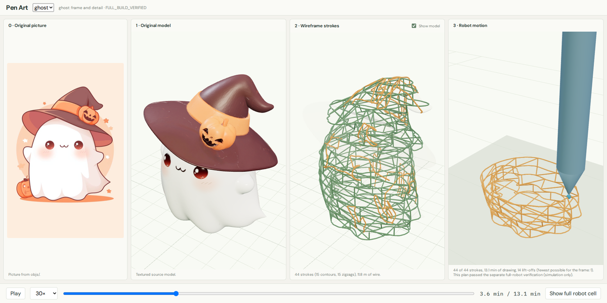

# Pen Art

Plan a wire sculpture that a robot arm draws in the air with a 3D pen, from a
mesh to a plan checked against the whole robot. Everything is simulation.



## What it does

A 3D pen pushes out plastic that hardens in a second, so a robot holding one
can draw a wire frame in mid-air, layer on layer, as in
[WirePrint](https://dl.acm.org/doi/10.1145/2642918.2647359). This repository
turns a mesh into a frame that stands, draws it in as few pen-down strokes as
possible, and finds arm motions that never hit the robot, the plate or the
wire already drawn.

## Setup

Linux x86-64 with git, git-lfs, curl and [uv](https://docs.astral.sh/uv/), on a
machine with many cores (planning uses 24 workers; pass `--workers` for fewer).
Unset `PYTHONPATH` first if your shell sets it.

```bash
unset PYTHONPATH
git clone https://github.com/gilwoolee/3d_art.git && cd 3d_art
./setup.sh
source .venv/bin/activate
```

Setup pulls the mesh, makes `.venv`, fetches the Flexiv robot description into
`.cache/`, builds the robot cell and builds the viewer.

## Steps

Each step is one command, run in order; results go in `runs/NAME/`. A step run
out of order, or after its inputs changed, stops and names the step to run.
Use `--help` on any command for its options.

Each object keeps its frame in `frame/`, optional detail in `detail/`, and
selected geometry, timing and verification files in `plan/`. Shared robot
assets are in `cell/`; retry diagnostics and worker files are under `.work/`.
After updating, regenerate any run reported as unsupported using these steps.

**`pen-art cell`** builds the robot cell from `configs/cell.yaml`: a Flexiv
Rizon 4 arm, a 256 × 256 mm build plate on a 10 cm stand in front of it, the
pen, and the largest object size (15 cm). Run it again after editing the file.

**`pen-art frame examples/ghost/cute_ghost.glb --name ghost`** slices the mesh
into horizontal loops joined by zigzags, with a crossed grid on the plate, and
scales the object so the frame needs at most 10 m of wire. It adds short
connector wire so the frame can be drawn in one stroke, and checks that it
stands.

**`pen-art detail ghost`** (optional) finds long strokes along the creases of
the mesh, drawn over the frame with one pen orientation each. It keeps up to
2 m and 15 added minutes of them, plus spare strokes for the next step.

**`pen-art plan-geometry ghost`** finds a collision-free arm path for every
stroke, in build order, without timing. It keeps the pen down from one stroke
to the next where it can, to keep lift-offs few. A detail stroke the arm cannot
draw is replaced by a spare.

**`pen-art plan-timing ghost`** times the paths once: drawing speed, cooling
holds, and the arm's speed and acceleration limits. It gives the print time
and never adds or removes strokes.

**`pen-art verify-full-robot ghost`** replays the saved plan with the whole
robot against the cell and all the wire built so far. Only a plan that passes
(`FULL_BUILD_VERIFIED`) counts.

**`pen-art view`** serves the viewer at http://127.0.0.1:8765: the object's
picture, the textured model, the frame (green) and detail (orange), and the
robot drawing it.

## Code

Each step's entry point is short and calls one function per stage, so you can
read a step top to bottom. Python code is in `src/pen_art/`; the browser viewer
is in `viewer/`. The example mesh, reference picture and preview are together
in `examples/ghost/`. Downloaded dependencies live in the ignored `.cache/`.

| Step | Where |
| --- | --- |
| Commands, stage order | `cli.py`, `stages.py` |
| `cell` | `cell.py`, `robot.py`, `planning/tool.py` |
| `frame` | `frame.py`; loops and zigzags in `abstraction/wireprint.py`; one-stroke connector wire in `abstraction/connectors.py`; standing check in `structure.py` |
| `detail` | `detail.py:generate_detail` |
| `plan-geometry`, `plan-timing` | `planning/section_build.py:build_round` runs a round; `planning/parallel_build.py` farms the strokes out to workers; `planning/cell_planner.py` plans and checks one stroke |
| `verify-full-robot` | `planning/cell_replay.py:replay_cell` |
| `view` | `server.py`, `viewer/src/` |

Collision checking is in `planning/collision.py` (the robot), `planning/scene.py`
(the wire laid so far) and `planning/pen_spheres.py` (the pen). Inverse
kinematics is in `kinematics.py`, and timing in `timing.py` and
`planning/clock_path.py`.

## Development

There are no tests. Check a change by running the ghost through every step and
comparing the lines each step prints with those before the change. Runs are
reproducible, so the saved plans can be compared too (timings, and a few
verification counts that depend on which worker checked what, still vary).

```bash
.venv/bin/ruff check src
(cd viewer && PATH=$PWD/../.cache/node/bin:$PATH npm run build)
```

Settings are in `configs/`. The pen, wire and arm limits there are
assumptions, not measurements.

## License

[MIT](LICENSE), including the mesh and picture in `examples/`. The Flexiv robot
description cloned into `.cache/` keeps its own license.
