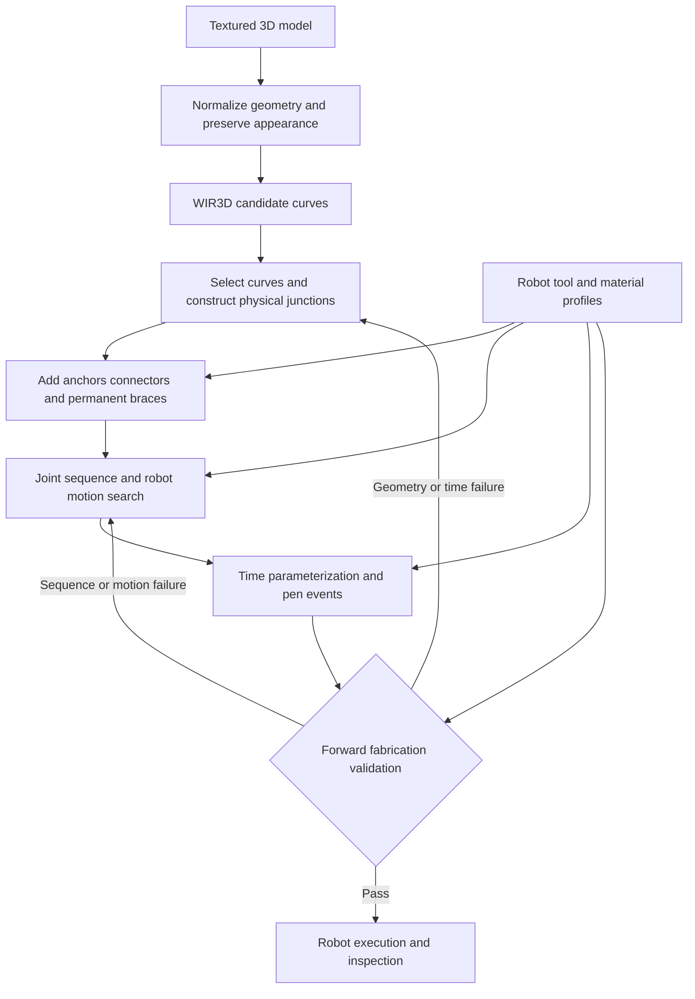

# Mesh to One- and Two-Arm 3D Pen Sculpture Plan

**Date:** 2026-10-10  
**Status:** Implementation in progress; scope includes two-arm planning. Hardware target: Flexiv.

**Current planning priority:** The [Caelan build-order plan](2026_1011_caelan_build_order_plan.md)
supersedes the local trajectory-repair strategy below. First establish a valid
fixed structural graph, then search construction order with pen-off restarts and
robot transit feasibility. Prior runs and the notes below remain historical evidence.

**Latest user priority (2026-10-11):** Complete the whole Palace pipeline with
**one physical robot arm first**, without a fabrication-time target or overall
planning timeout. Use `runs/palace_15cm_one_arm` and
`configs/cell/one_flexiv_right_angle_lean.yaml`; the second robot is absent,
rather than parked in the scene. Keep the same 15 × 15 × 9 cm Palace, selected
curves and automatic supports. The existing right-angle pen bracket and fixed
10° inward nozzle lean are the initial provisional tool assumptions. Motion
preparation may adjust pen orientation to clear deposited material while
preserving the Cartesian stroke. Two-arm
work is deferred and its saved artifacts are preserved. The runner's
`--no-time-limit` option removes the overall and catalogue timeouts while
retaining the fixed motion catalogue and bounded failure-driven repairs.
Completion still requires the entire generated trajectory to pass replay;
physical execution additionally requires measured hardware/process calibration.

The one-arm catalogue is complete: 64 paths, 6,082 saved poses, original source
geometry and tip targets retained. Evidence is saved in
`research/palace_one_arm_catalogue_complete.json`. The webpage has one-arm
setup and playback labels and reports the absence of an overall planning limit.
The generic `pen_art.build` command forwards `--resource-mode single` and
`--no-time-limit` to the same runner and skips geometric half-splitting when
the configured cell contains one robot.

The current one-arm obstacle is tool clearance along a contour's own deposited
material near the platform. Reordering entire actions cannot fix that case.
An automatic pen-pose/IK repair is being integrated and checked. A transported
transverse direction supplies a geometric preference; constrained pen-pose
optimization and a bounded orientation lattice seek clearance, followed by
arm IK, continuous tracking, collision validation and retiming. Sampling alone
does not accept a repair. The required collision margin remains 1 mm.

**Previous two-arm priority (2026-10-11):** Complete a working Palace wireframe pipeline
before optimizing fabrication duration. The former 30-minute target is advisory,
not an acceptance gate. Preserve the current uniformly scaled 15 × 15 × 9 cm
Palace, its selected contours and automatic supports. Finish all selected robot
motions, retime the complete build and validate shared-clock replay. Report the
resulting duration even if it exceeds 30 minutes. Offline planning has a separate
one-hour resumable compute allowance; keep the fixed motion catalogue and bounded
failure-driven repairs. Do not loosen geometric clearance or robot motion limits.

The retained vertical mount branch is `runs/palace_15cm_right_angle_cell`, using a
physical 90° tool bracket with a vertical pen, provisional 120 mm lateral wrist
offset and 160 mm vertical flange-to-tip drop. These are modeled dimensions,
not measured pen specifications. All 128 arm/action drawing paths were generated;
its latest motion batch stopped at the material obstruction described below.
An FK check of their 12,164 saved poses confirms vertical nozzle axes and the
same source stroke geometry, supported graph and construction actions
(`research/palace_right_angle_catalogue_complete.json`). This checks sampled
kinematics, not full motion or shared-clock clearance. The previous 30° pen-tilt
run and matching single-arm baseline remain independent comparisons.

A fixed three-option study of the same 12 stroke points per arm compared upright
bases, 45° yaw on the table and 45° inward base tilt. Results respectively were
24/24, 24/24 and 17/24 individually clear poses; 5/6, 5/6 and 2/6 clear paired
poses; and 10.2%, 10.1% and 2.8% minimum best-solution joint-limit margin.
Keep upright bases for the current placement. This finite static study does not
establish a global optimum or certify any full trajectory. The workbench's
**05 Two-arm setup → Base mounting assessment** displays each candidate and
its paired configurations. Base tilt keeps the nozzle vertical in world
coordinates. The physical wedge, cable routing, load and gravity configuration
remain outside this model. Evidence is saved as
`runs/palace_15cm_right_angle_cell/cell_mounting_assessment.json`.
The rendered comparison now overlays the actual selected Palace wireframe in
the shared world frame (`research/palace-base-mount-wireframe.png`); it is
labeled as the target reference, not material already deposited.

The active 10° pen-lean configuration has also been assessed using the same
three base options and fixed samples. Upright and 45° yaw each give 24/24 clear
individual poses and 6/6 clear pairs; 45° inward base tilt gives 7/24 and 0/6.
The configured pen lean is applied while keeping the same world-frame tip
targets across mounting options. This reinforces the upright-base choice for
this placement, without claiming a complete trajectory or a global optimum.
Evidence: `runs/palace_15cm_right_angle_lean_cell/cell_mounting_assessment.json`.

The earlier tilted comparison runs now have all 64 prepared motions and full
timed candidates: 2,687.218 s (44.8 minutes) with two arms and 4,298.318 s
(71.6 minutes) with one arm. Both are undergoing complete replay; these numbers
are not yet validated durations or achieved speedup. The older 31.5-minute
allocation-only estimate omitted the final realized overhead. The full two-arm
candidate was rendered through its exact final frame and restarted successfully
(`research/palace-tilted-full-schedule-end.png`). Automatic progress refreshes
now wait for an active stage load, preventing repeated interruption of large
schedule downloads. Artifact checks also retain the originating run ID while
asynchronous requests finish.

The right-angle catalogue initially hit a numerical retiming failure. Timing
eligibility now records results per fixed arm/stroke mode in
`allocation_timing.json`, retaining matching results across resumption. Known
numerical failures are marked `TIMING_UNRESOLVED` and excluded from allocation;
other modes remain available. Input/configuration errors still propagate.
Failure to time one mode does not prove that its stroke is physically impossible.
The first error is preserved in
`research/palace_right_angle_first_timing_failure.json`. Timing now completes
for 127 of the 128 fixed modes. Only arm 1's `draw-0039` mode remains unresolved;
arm 2 has a timed mode for that stroke, so all 64 construction actions remain
eligible. This is solver eligibility, not full-motion validation.

The right-angle motion runs exposed specific nozzle-shank collisions with posts
already deposited near later base strokes. Preparation now extracts those named
material obstructions and adds conditional finish-before-start constraints to
the fixed CP-SAT problem. Each observed moving mode must precede every eligible
arm's mode for the blocking stroke. These constraints retain all contours and
supports, coexist with required support/cooling dependencies, and survive final
retiming. They are conservative scheduling repairs, not a claim of global
infeasibility. Linear and polynomial material names are both recognized in
preparation and shared replay. Two focused scheduling/parser tests pass.
The workbench exposes these repairs in **05 Two-arm setup → Material ordering
constraints**: the first stroke is blue, the blocking stroke is bronze, and the
unchanged Palace remains visible in gray. It also reports whether each
conditional constraint applies to the current allocation. Complete right-angle
motion preparation and shared replay remain unfinished. The latest vertical
right-angle batch stopped after 8 of 64 motions: arm 2's approach to
`backbone-post-004` encounters the pen body near `backbone-post-003`. A separate
diagnostic reconstructs that exact completed-material prefix. The original
vertical start pose has no clear IK solution in that diagnostic; a single fixed
10° inward nozzle lean produces a clear solution at the unchanged TCP position
and 1 mm clearance (`research/palace_right_angle_material_lean_probe.json`).
This is one static pose check, not a complete-path certificate.

The active continuation is `runs/palace_15cm_right_angle_lean_cell`, using
`configs/cell/two_flexiv_right_angle_lean.yaml`. It retains the same physical
right-angle bracket, upright bases, source geometry and tool dimensions, with
that fixed 10° nozzle lean. It regenerates the fixed arm/action catalogue and
uses the existing bounded allocation/realization process. The vertical run and
its failure evidence remain untouched. Complete motion and shared replay are
still required. The material-order visualization was verified in the browser
(`research/palace-material-order-constraints.png`); build and the three existing
frontend checks pass.
All 128 paths in the 10° catalogue are now generated. An FK check of all 12,164
saved samples confirms the original tip targets and configured inclination;
the source meshes, stroke graph and construction actions match the vertical
right-angle run exactly (`research/palace_right_angle_lean_catalogue_complete.json`).
Timing and full-motion realization remain separate. The drawing-path view now
sets its own title, scope and legend when switching away from structural regions,
and labels pen roll separately from the 10° nozzle inclination
(`research/palace-lean-fixed-path-view.png`).

**Replay resumption:** `planning/replay_checkpoint.py` saves exact deposited
capsules only at completely checked event boundaries. Checkpoints bind the full
plan hash, source input hashes, live robot collision mesh hashes, tool metadata,
process/timing settings, Python/package versions and the checking implementation.
Changing a schedule or any bound input restarts replay. The unfinished part of
a rejected or time-limited interval is never accepted into the checkpoint.
Robot configurations, active motions, completed strokes and support cooldowns
are reconstructed from the same bound plan on resumption. Material capsules keep
their exact previously checked inflation and clipping. A focused regression
checks interruption while one arm remains active, matching continuation and a
fresh replay, invalidation after a plan change, and rejection of corrupted
material. The workbench's replay status includes the resume time.

The two earlier comparison replays are left running with their existing code.
The 10° fixed-catalogue process was stopped cleanly and resumed with all 51 saved
drawing modes intact so its subsequent replay can use the new checkpoint code.
Neither this implementation nor the regression constitutes a completed Palace
replay or physical validation.
A two-process check using the first two real Palace actions also passed: the
first process checked 438 intervals; the second restored the exact material at
63.6446 seconds, reused both path checks, and preserved the same interval count.
This is deliberately a two-action prefix, not a full-build claim. Evidence is
`research/palace_real_replay_checkpoint.json`. All 51 cached 10° drawing modes
were verified unchanged after the process restart.
The active 10° run is now the default for a fresh workbench selection; an
existing browser's explicitly selected run remains selected.

The original vertical-pen run at
`runs/palace_15cm_bounded_clock_cell` retains all 64 motion paths and its rejected
35.1-minute schedule. It is preserved as failure evidence, not a working build.

In the workbench, **06 Robot motion** opens the available individual motions
with **Play robot motion** above the 3D view. When a shared schedule exists,
**07 Pen timing** opens its synchronized player with **Play both arms** in the
same place. Both players display the status of the underlying artifacts;
playback does not turn a rejected or unverified schedule into a valid build.
Deposited segments are batched into one graphics object while preserving gaps
between strokes. The saved full Palace schedule was checked in the browser:
seeking to its exact endpoint, restarting, and scrubbing the shared clock work.
This verifies the viewer controls, not the rejected schedule's fabrication.
The shared timeline now groups adjacent intervals within each action into
phases and explicitly shows idle periods. The saved vertical Palace's 31,938
motion intervals render as 516 phases including waits, with unchanged duration
for every motion kind (`research/palace_timeline_phase_check.json`). Clicking
the arm-2 wait at 1,902.760 s was checked in the browser: arm 1 remained in DRAW
with feed ON, while arm 2 showed WAIT with feed OFF. This only verifies timeline
display and seeking; it does not change the underlying rejected trajectory.

The fixed-catalogue runner and mesh entry point now accept `--resource-mode
single` for a one-active-arm baseline in a separate output run. It selects the
saved single-arm allocation, retains both physical robots for collision replay,
and uses the same preparation, retiming and bounded-repair path. Changing resource
mode in an existing motion run is rejected before overwriting its results. The
webpage labels this mode explicitly and associates diagnostics with its actual
allocation. This implements the baseline route, not a completed baseline result;
matched full-trajectory comparison remains outstanding.
The matching baseline has now started at `runs/palace_15cm_tilted_single_cell`
with a separate one-hour resumable budget. Before starting, the source graph,
continuous strokes, construction order, cell, fixed motion catalogue and
process/timing configuration were checked for exact agreement with the tilted
two-arm run. First individual motions have been saved; full schedule/replay
remain pending (`research/palace_single_baseline_started.json`). The rendered
workbench labels this run **one active arm** and defaults its resource selector
to **One arm baseline** (`research/palace-one-arm-baseline.png`). Both physical
robot models remain present for collision checks.
`cell_comparison --run TWO_ARM_RUN --single-run ONE_ARM_RUN` accepts the separate
offline runs and preserves local input/plan/replay snapshots for the webpage.
It requires identical geometry, cell, candidate catalogue, process, clock and
initial poses, plus full matching replay certificates, before reporting speedup.
A failed replay no longer labels its whole planned horizon as validated.

The first tilted allocation prepared 41 motions before `draw-0010` on arm 2
exposed a smoothing error: a 0.3023 mm sampled deviation and a 0.5122 mm bound
against the unchanged 0.3 mm tracking limit. One automatic allocation repair
had already begun before this was identified as an interpolation issue. The
planner now tries only 2, 4 and 8 numerical subdivisions of the existing joint
segments, keeps the same original drawing samples and endpoints, and rechecks
the full interpolant. Four subdivisions bounded the full offending drawing at
0.2996 mm (`research/palace_full_tracking_refinement.json`). This is not a motion
collision or complete-build certificate. Tracking failures no longer produce
irrelevant order constraints. The run resumes the replacement allocation's 11
saved motions; the earlier failure and restart evidence are retained in
`research/palace_tracking_repair_checkpoint.json`. Prepared-motion inspection
now shows each saved drawing's tracking bound.

The one-arm baseline's first order then failed to approach `draw-0038` after
21 motions. Replaying that exact saved material prefix showed that its upward
lift exceeded the 0.3 mm tracking bound at 3 mm sampling (bound 0.3045 mm), while
1.5 mm sampling passed. `transit.find_departure` now retries the same Cartesian
ray at half and quarter spacing only when a tracking rejection occurred; every
new edge must pass the original tracking and collision checks. It does not retry
pure collision or missing-IK failures by densifying. Approach/withdrawal reports
retain each direction's tracking and collision evidence. The formerly rejected
complete motion now prepares in the exact old prefix, with a modeled duration
of 55.65 s (`research/palace_single_approach_refined.json`). This is an individual
motion result, not a full replay certificate. Five existing transit tests pass.
Both offline runs were stopped and resumed to load the fix, retaining their
current allocations and all 33 dual-arm and 20 single-arm saved motions
(`research/palace_lift_restart_checkpoint.json`).

A follow-up performance check found no benefit from rebuilding the collision
tree: eight tip probes against the same 25,261 deposited capsules returned
identical distances and narrowphase counts (`research/palace_scene_tree_benchmark.json`).
The expensive queries instead involved the wrist's broad bounding volume.
The checker now first measures the actual link against the filled box containing
all deposited capsules. It can skip the detailed query only when this lower bound
exceeds the required clearance plus the entire interval's motion allowance and
the numerical reserve. Otherwise the original detailed query remains unchanged.
At three poses of the current `draw-0032`, the box distance was 123–150 mm;
box queries took 6–9 microseconds versus 30–41 ms for 38,536-capsule queries
(`research/palace_material_box_probe.json`). The complete selected motion then
prepared in 16.97 s with unchanged limits (`research/palace_full_box_probe.json`).
The 12 existing scene/collision/coordination tests pass, including curved interior
collisions and comparison with both early exclusions disabled. Both jobs resumed
with their exact allocations and all 33 dual-arm / 21 single-arm cached motions
preserved (`research/palace_box_restart_checkpoint.json`). Full replay is pending.

The following notes record earlier implementation checkpoints and diagnostics.

The resumed batch reuses that exact allocation and its 18 saved motions with a
3,600-second allowance. Material checks now also support a conservative early
exclusion: a link's enclosing sphere must be farther than the full interval's
required clearance from the box containing every deposited capsule before its
FCL query can be skipped. All other links use the original detailed check. The
12 existing scene/collision/coordination tests pass, including a curved interior
collision and comparison against checks without early exclusion. Three sampled
Palace poses reduced detailed material queries from 24 to 1 with identical
clearance outcomes (`research/palace_material_culling_benchmark.json`). This is
a component measurement, not an end-to-end speedup. The compute-only run was
deliberately stopped and resumed to load this change, preserving the allocation
hash and 18 saved motions. `PLANNING_INTERRUPTED` now retains a resumable
checkpoint separately from an expired planning budget.

The secondary torus integration run prepared all 22 motions and exposed an
overly coarse replay speed bound near fast interval endpoints. The checker now
allows 16 rather than 10 interval bisections, with the same speed limit and
tolerance. One previously unresolved bound changed from 0.00300513 m/s to
0.002999993 m/s against a 0.003 m/s limit; neither geometry nor timing changed
(`research/replay_speed_bound_refinement.json`). The existing timing test now
covers an endpoint speed maximum and rejects an overspeed clock. Full replay
remains a separate requirement. Resumption also preserves a complete selected
allocation after a replay/return error when all source hashes still match.
Checkpoint restoration retains every matching saved motion even if decoding is
interrupted, instead of temporarily replacing the checkpoint with a partial set.
The same early checkpoint now retains repair constraints and prior replay
attempts. A controlled interruption at the first cached-path decode preserved
all 64 motions, four constraints and four replay records in an isolated Palace
copy (`research/palace_resume_integrity_probe.json`). Deliberate interruptions
also change running motion/replay stages to partial and preserve their input
hashes; the live planning run was not interrupted for this check.

Shared-clock repair now also handles named deposited-material obstructions.
The torus replay exposed a base-connector approach through a previously printed
post. The planner maps the obstruction back to its depositing stroke and adds
a fixed-mode precedence constraint: finish the obstructed motion before that
strand is deposited. Existing anchor, cooling and arm-order constraints still
apply; a conflict returns infeasibility rather than bypassing support. This uses
the same bounded repair loop as inter-arm exclusions and idle-arm parking and
does not generate or split curves. The existing scheduling test verifies the
longer dependency-respecting schedule and rejection of a contradictory order.

Replay now writes a current-plan audit before the continuous motion-limit
checks, rather than leaving an earlier schedule's failure visible throughout
that phase. The workbench distinguishes path checks from shared-clock collision
replay and shows checked action/interval counts. Speed-bound refinement observes
the offline deadline; reaching it returns `REPLAY_TIME_BUDGET` with saved progress
and leaves the allocation resumable. This result establishes neither a collision
nor a successful replay. A focused regression verifies that an interrupted speed
check preserves its progress and is reported as incomplete; the frontend checks
cover the corresponding status labels.
An isolated replay of the actual Palace clock with a two-second allowance
checked 372 of 31,937 intervals before returning that incomplete status
(`research/palace_replay_budget_probe.json`); the live run was not modified.
The schedule view also provides a camera-only sculpture close-up alongside the
full robot-cell view. Neither camera control changes the 15 cm build geometry.
Generated two-arm views hide the solid reference mesh by default, with a separate
checkbox to show it for comparison, so the sculpture can be judged as wireframe.

The fixed-path repair loop now reuses completed kinematic-limit checks within
one planning process. The exact path, arm, robot file, cell profile, settings and
source hashes must match. Changing start times alone retains that result; all
schedule continuity, pen events, anchor readiness, inter-arm and material
collision checks still run again. No partially checked path is reusable, and
restarts do not inherit these certificates. An isolated check of one actual
Palace motion passed prefix replay before and after a one-second start shift:
1.78 seconds initially and 1.13 seconds with reuse, including fresh collision
checks (`research/palace_replay_reuse_probe.json`). This is a component check,
not a full-build timing or success claim. The existing timing regression checks
reuse plus invalidation when process settings change.

At the 07:45 UTC replay snapshot, the Palace's first two overlap conflicts had
produced two pairwise scheduling exclusions. The next check reached two completed
strokes and found arm 1 approaching the stationary arm 2 after
`backbone-post-004`. Automatic repair added a 28.4-second parking move and rebased
arm 2's next approach, preserving the selected drawing paths. That candidate's
full duration is 2,057.142 seconds (34.3 minutes); it is still awaiting a complete
passing replay. These are timing/motion repairs, not changes to the sculpture.
The allocation page now lists those recorded repairs separately from current
replay status. Each available witness can display the recorded robot poses and
highlight the named inter-arm collision links. The full wireframe remains a
reference in this diagnostic; it does not represent the deposited prefix at
the old witness time. Returning to another view clears those link highlights.
The following replay found the parking transit itself overlapping arm 1's
approach, so the same bounded loop added a non-overlap constraint between those
complete motions. The next candidate totals 2,103.514 seconds (35.1 minutes).
It remains a schedule candidate until the full replay passes; a successful
individual parking transit does not establish simultaneous two-arm clearance.

A systematic alternative is now implemented as a separate fixed orientation
policy: `drawing_pen_tilt_deg: 30` in `configs/cell/two_flexiv_tilted.yaml` points
each pen inward toward the build center, putting its wrist toward its own base.
Zero tilt retains the original rotation exactly. This uses the 7-DoF arms'
orientation freedom without changing the wireframe or scanning new curve sets.
The vertical run has now terminated with `SCHEDULE_REPLAY_REJECTED` after six
repairs and seven replay attempts. All 64 motions remain available, but the final
replay completed only two strokes and 391 intervals before a wrist collision at
66.32 s. The final candidate duration is 2,103.514 s (35.1 minutes). The evidence
is retained; the vertical search is not being extended.

`planning.orientation_probe` selects the latest recorded inter-arm witness and
performs one IK solve per arm at the same TCP positions using the fixed tilt.
For the tested Palace wrist conflict, flange spacing increased from 10.4 cm to
23.8 cm and the known arm bodies cleared at that pose, with under 0.001 mm of
tip displacement. It checks the saved cell/robot/tool provenance and writes
`pen_orientation_probe.json`, exposed as **Pen-angle diagnostic** in the webpage.
The result is a static diagnostic only. A separate full run is now active at
`runs/palace_15cm_tilted_cell`, with the same source graph, uniform scale and
automatic supports. It has completed all 128 arm/action groups: one fixed
30° drawing mode for each of 64 actions on each arm. The maximum sampled
interpolation error is 0.0163 mm; that sampled result is not a continuous
trajectory certificate. The first allocation estimates 1,874.192 s (31.2 minutes)
for two arms and 3,543.235 s (59.1 minutes) for arm 1 alone. Selected full motions
are now being prepared; their travel/approach/departure costs and shared-clock
replay are still pending. These allocation estimates are not completed-build
durations. The completed catalogue
and unchanged source-file hashes are recorded in
`research/palace_tilt_catalogue_complete.json`. This run does not replace the
original vertical-pen evidence.
The webpage reports configured and per-candidate pen angles, and retains the
selected candidate, waypoint and reference toggle across live checkpoints.
Pen/mount geometry and physical extrusion behavior remain unmeasured.

**Updated goal:** Implement this end-to-end plan, including flexible two-arm task
and motion planning, and show every step with visual output in the webpage.
Retain the single-arm implementation as a baseline and fallback. Two-arm planning
is now a required deliverable, not an optional future idea.

Given a textured 3D model, generate an artistic, recognizable, connected sculpture
that one or two 7-DoF robot arms can fabricate. Each arm carries its own rigidly
mounted commercial 3D pen, with its TCP at the pen tip. The output is a shared
schedule of arm motions and independent pen commands. The process must connect
the sculpture automatically, without hand assembly between strokes.

The selected architecture is **WIR3D for visual abstraction, automatic graph
construction and repair, offline resource allocation for one or two arms,
and calibrated pen-aware timing**. Garrett-style checks supply construction and
motion feasibility. The two-arm scheduler uses fixed motion options and minimizes
completion time. The preferred geometric variant now partitions strokes into
work-balanced arm-side regions and a shared seam; unrestricted assignment remains
a comparison. Use sparse spatial strokes with a small permanent supporting structure.
The current scope is wireframe only: recognizable contours and their permanent
supporting struts. Surface filling, shells, sanding and finishing are excluded.

**Practical pen-first revision:** Use continuous spatial drawing strokes, deliberate
joins, and cooling pauses. An intersection in the material graph does not require
a new extrusion start. Keep source contours continuous where possible; rotate
closed contours to begin at an available anchor. Use a small printed base/frame,
then add recognizable contours. Unknown pen limits are calibration questions,
not hard printer-style overhang or span rules. Start with constant temperature
and feed settings per job and a few representative pen experiments. Sparse WIR3D
designs and completing the end-to-end pipeline take priority over detailed mechanics
of a dense cross-section baseline.

This integrates existing research and new components. Asset conversion, geometric
supplemental curves, the pinned WIR3D adapter, remote progress/import, and the
local visual workbench are implemented. The mesh has a 150 mm maximum extent
(approximately 150 × 150 × 90 mm) and produced 64 geometric candidates. WIR3D's
first completed budget has now exported 29 actual curves; the requested budget
is not the actual output count. Larger budgets remain in progress. Simulation
components cover geometry, drawing paths, order repair, timing previews and a
new two-arm setup view. Full-tool/process validation, coordinated scheduling and
an executable robot program remain outstanding.

The user has two **7-DoF Flexiv arms** available for the planning scope. Exact arm
variants, base transforms, pen/mount geometry, and pen configurations remain to
be supplied or measured. Existing robot results use one provisional Rizon4 and
do not establish two-arm feasibility. Blondie's RTX 5090 passed an actual CUDA
matrix multiplication in the isolated PyTorch 2.8.0/CUDA 12.8 environment. Its
NVML monitoring tool reported a driver/library mismatch; CUDA computation itself
passed.

## 1. Scope and success criteria

| Requirement | Interpretation |
| --- | --- |
| Input | A triangle mesh with optional texture, such as a Meshy GLB or OBJ asset |
| Appearance | Recognizable from several viewpoints, with smooth, selective strokes rather than dense surface reproduction |
| Robot | One-arm baseline and two-arm planner; two 7-DoF arms, each with its own rigid pen and tip TCP |
| Pen | A selected SCRIB3D or 3Doodler PRO+ configuration, represented by a measured hardware profile |
| Connectivity | Every component is joined automatically; the final material graph remains connected without the build surface |
| Construction | Each intermediate structure and each partially deposited stroke must be feasible |
| Time | Report the full estimated and measured duration; 1,800 seconds is an advisory future optimization target, not a completion gate |
| Two-arm coordination | Automatic assignment and concurrent scheduling with continuous inter-arm, tool, environment, and growing-material collision checks |
| Comparison | Compare one and two arms on the same graph, scale, pen assumptions, and validation criteria; report achieved speedup rather than assume it |
| Webpage | Show both arms, assigned strokes, construction growth, synchronized timelines, waits, conflicts, and comparable one-/two-arm timing |
| Generality | The same pipeline and hardware profile operate across object categories without per-object connection editing |

Offline mesh processing, WIR3D optimization, and planning have separate compute budgets. They are excluded from fabrication duration. The current motion-planning run has a one-hour resumable allowance. An image-to-finished-object deadline would require an additional end-to-end latency target.

For the first version, use one material, one color, one nozzle, and a fixed temperature per job. Feed settings may change only where the hardware supports automatic control and calibration covers the transition. Nozzle changes are setup operations. Multiple printing strokes and pen-off travel are allowed; the sculpture need not be made with one uninterrupted extrusion.

Routine loading and removal of the completed object are outside automated construction. Joining pieces, holding strands by hand, changing filament during a job, and removing temporary supports between strokes are outside the initial workflow. Permanent connectors and braces must be included in the visual design and time estimate.

Generalizable does not mean every mesh is fabricable at every requested size. The planner should either produce a validated candidate or return a specific reason that no acceptable plan was found within its search budget.

Keep the current maximum extent at **150 mm with uniform scaling**. Adding an arm
does not change the object's proportions or justify enlarging it. Both arms may
access overlapping regions when feasible. A second arm need not be active at all
times, and simultaneous drawing is not required where sequential drawing is safer
or faster. Holding a hot strand with the other pen is not assumed; it would need
a separate contact skill and calibration.

## 2. Starting asset and current workspace

Use [the textured Palace Reflections GLB](../Meshy_AI_Palace_Reflections_1011014238_texture.glb) as the first example. Its embedded mesh has 2,853,254 triangles, 1,558,185 vertices, UV coordinates, and three image resources. These counts were read from the local GLB metadata. Its coordinates do not establish a physical printing scale.

The untextured GLB and two STL exports are also present. Prefer the textured GLB for abstraction; preserve texture information during conversion to the input format expected by WIR3D.


The preview shows the source model, not generated strokes or a fabricated result. Its broad visual features include a dome, an upper circular band, repeated columns, openings, and a base. They provide useful evaluation targets, but the algorithm must discover useful curves through geometry and image evidence rather than a hard-coded architectural recipe.

The workspace now contains application modules, tests, configuration profiles and the local visual workbench. The checklist below distinguishes implemented components from outstanding integration and physical validation.

## 3. Existing methods and their roles

| Component | Reuse | Work required for this project |
| --- | --- | --- |
| WIR3D | Textured mesh to sparse 3D cubic Bézier curves | Import/export adapter, automatic keypoints, candidate ranking, and fabrication constraints |
| Garrett et al. spatial extrusion planner | Construction sequence and robot motion search | Curved stroke actions, the chosen 7-DoF robot and pen geometry, process checks, and timing feedback |
| Descartes-style layered IK graph | Search among robot configurations along a prescribed tool path | Curve sampling, orientation constraints, collision evaluators, and continuous path validation |
| TOPPRA | Time parameterization of a prescribed joint path | Calibrated deposition-speed constraints and synchronized pen events |
| RL Toolpath Planner | Alternative printing-sequence optimizer | Independent benchmark plus full-arm motion validation and recovery |

[WIR3D](https://threedle.github.io/wir3d/) optimizes curves using geometric and visual evidence, including texture. Its two stages capture coarse shape and finer features; semantic keypoints can be detected automatically. Connectivity, structural support, and robot execution are additional requirements here.

[Garrett et al.](https://arxiv.org/pdf/2002.02360) jointly reason about extrusion sequence, intermediate stiffness, and robot motion. We select Regression with the StiffPlan heuristic as the starting search architecture. The published formulation uses straight elements and fixed tool orientation during an element. Our curved, temperature-dependent extension will require separate validation; the paper's theoretical guarantees do not automatically transfer.

The [RL Toolpath Planner](https://arxiv.org/html/2408.09198v1) overlaps with Garrett at sequencing. Its wireframe planner uses local graph search, deformation evaluation, and printer-head collision reasoning. Section 7.5 leaves full-arm feasibility to IK and acknowledges that a collision-free IK solution may not exist. It is an alternative to benchmark, not a second mandatory sequencer. An RL-guided robot-aware search would be a further integration project.

The [WIR3D implementation](https://github.com/threedle/wir3d) documents OBJ input with optional texture, output curves at `seed0/sem/tot_bestcurves.pt`, Blender 3.6, a GPU with at least 24 GB memory, and CUDA requirements. It reports preprocessing of roughly 1–3 hours depending on the system. Plan for a separate compatible GPU environment; do not assume this Mac can run its documented stack directly.

## 4. Pipeline and data contracts



Keep the artistic curve, fabrication action, numerical discretization, and timed robot samples distinct. One Bézier curve may need several fabrication actions at real junctions. One action may require many numerical samples without becoming many extrusion starts.

| Artifact | Required information |
| --- | --- |
| `asset_manifest.json` | Source hash, units, orientation, physical scale, coordinate transforms, texture resources, and preprocessing settings |
| `curve_candidates.json` | Persistent curve IDs, Bézier control points, source features, visual scores, and protected landmarks |
| `stroke_graph.json` | Junctions, curves, physical diameter, connector/brace labels, ground contacts, and optional versus required strokes |
| `pen_strokes.json` | Continuous contours, constituent material members, junction visits, and allowed closed-contour starting points; junctions do not imply feed stops |
| `construction_plan.json` | Directed stroke actions, joins, dependency alternatives, and robot path references; retain the existing single-arm form |
| `dual_arm_plan.json` (new) | Arm assignment, motion alternatives, start/end times, support/cooling dependencies, waits, spatial conflicts, and shared construction events |
| `joint_path.json` | Per-arm joint names, continuous path representation, Cartesian error bounds, tool poses, and collision-validation metadata |
| `trajectory.json` | Per-arm timed joint positions and derivatives, independent synchronized pen events, controller assumptions, and profile hashes |
| `trajectory_manifest.json` | Source-plan and export hashes, matching replay status, channel IDs and explicit simulation-only scope |
| `dual_arm_validation.json` (new) | Continuous pairwise collision evidence, shared-time material replay, unmet constraints, makespan, and matched single-arm comparison |
| `validation_report.json` | Recognition measures, connectivity, structural/process checks, collision and kinematic checks, duration, and unresolved failures |

`trajectory.py` now exports `joint_path.json`, `trajectory.json` and the hash-bound
manifest from a saved full offline schedule. Position coefficients are exact
polynomials in normalized segment time. Velocity/acceleration coefficients
include the segment's physical duration. Explicit constant-position intervals
cover arm waits. TCP endpoint transforms use the snapshot's world/base and tip
offsets; they are reference poses, not a new linear Cartesian interpolation.
The exporter checks source hashes and joint-channel continuity. It does not send
commands or certify controller interpolation, jerk, material behavior or tracking.
It preserves failed/pending replay status instead of making an executable claim.

The retained 29-curve Palace run exercises this export with 2,721 intervals across
two arms. All derivative coefficients were checked, and 7,977 source-position
comparisons had maximum error below 1.4e-15 rad
(`research/trajectory_export_validation.json`). That run still has a rejected
geometric replay. The active 33-curve Palace run will use the same export once
its full trajectory is available; it is not exported prematurely.

`validation.py` writes a separate `validation_report.json` snapshot for completed
or interrupted pipeline batches. Its webpage table distinguishes connected
material and grounded-order checks, prepared motions, shared replay, uncalibrated
structural/process screens and untested physical fabrication. A cold-frame
solver failure with uncalibrated material parameters is labeled uncalibrated,
not proof that a pen sculpture cannot stand. Stale replay hashes cannot be
reported as a passing current replay. The initial summary was checked against
the saved Palace baseline and with one focused stale-evidence regression.
| `preview.glb` | Thickened strokes colored by construction order; connectors and braces separately inspectable |

Version all schemas. Use meters, radians, and seconds internally. Name robot, build, asset, flange, and TCP frames explicitly. Store every transformation needed to recover the source geometry and reproduce placement. Use explicit quaternion ordering where orientations are serialized.

For two arms, add a shared world frame and explicit `world_from_base` transforms
for `arm_1` and `arm_2`. Every action and pen event names its arm; each trajectory
contains seven joints for that arm on the same job clock. Preserve existing
single-arm artifacts and write two-arm experiments to separate run directories.
Include both robot/tool profiles, base transforms, graph, path, timing, and
calibration hashes in downstream validation inputs. Never interpret two
independently valid trajectories as a validated joint schedule.

## 5. Algorithm stages

### Stage A. Prepare the model and fabrication placement

**Problem:** A dense textured asset has arbitrary scale and may contain topology unsuitable for geometry processing.

**Proposed solution:**

1. Load geometry, material assignments, textures, and scene transforms. Preserve an immutable source asset.
2. Produce a geometry-processing copy and a faithful textured rendering copy. If simplification changes UVs, rebake appearance instead of silently dropping it.
3. Diagnose disconnected components, degenerate faces, normals, and surface validity. Prepare the surface representation required by WIR3D, while preserving meaningful holes and openings.
4. Establish an upright orientation from metadata and geometry. Evaluate several plausible build orientations when confidence is low.
5. Apply a requested physical size. Use the user-requested 150 × 150 × 150 mm maximum envelope and preserve proportions; this model occupies approximately 150 × 150 × 90 mm. Physical printability still requires pen calibration.
6. Place the model within the shared robot workspace. Search object XY placement,
   yaw and platform height, with candidate arm-base placements only where the
   physical mounting arrangement permits them. Score access for both arms,
   clearance, and opportunities for concurrent strokes. Propose base contacts
   and a small printed base structure, then evaluate attachment and accessibility.

The shared model appears Y-up in the preview. Convert it consistently into the chosen build frame; physical dimensions must come from the job configuration. Optimize placement and orientation using generic feasibility and recognition scores.

**Output:** A normalized, textured asset and explicit scale and placement transforms.

### Stage B. Generate and score artistic curves

**Problem:** Printing triangle edges or a dense shell would not meet the intended style or likely time budget.

**Proposed solution:** Run WIR3D at several curve budgets, with automatic feature/keypoint selection. Convert its output to the common curve schema. Supplement candidates with geometric contours, ridge curves, or cross-sections only when the visual abstraction misses a persistent shape feature.

Score candidates using fixed multiview renders. Measure how removing each curve changes silhouette, internal edge evidence, and perceptual similarity. Evaluate the thickened, single-color sculpture against the textured reference; texture can guide the placement of a stroke without being reproduced as color.

Use a fixed validation view set in addition to optimization views. Include enough azimuth and elevation variation to prevent one-view silhouettes from dominating. Perceptual similarity is a proxy; retain human recognition evaluation as a separate acceptance check.

The selection objective should reward recognition and penalize total deposition length, unnecessary starts, visual clutter, and added support. Choose weights on a development set, then hold them fixed across evaluation objects. No category label or manual connection drawing is required.

**Output:** Several ranked curve sets with enough alternatives for fabrication repair.

**Visual review update:** Coverage alone has not preserved the Palace's identity.
The original 25-curve selection and its two-arm allocation are development
results, not an accepted sculpture. The workbench now shows source and strokes
side by side under one camera and scale. `abstraction/contours.py` adds automatic
surface outlines and opening boundaries to the fixed candidate pool, with
depth-jump splitting and bounded smoothing. Settings are in `configs/contours.yaml`.
`refine --contours --curves-only` stops before graph construction for this review.
The fixed-budget selector now receives a deterministic feasible starting hint;
it still performs just two bounded solves.

The `palace_15cm_contours` run selects 69 curves, totaling 3.39 m and approximately
20 minutes of drawing/feed before connections and motion. Its geometry remains
fragmented around columns and openings. The recorded visual review is
`NEEDS_REVISION`, despite improved outline coverage. Do not advance it to robot
planning as an accepted design. Coherent feature preservation remains unfinished;
the algorithm must preserve shape features rather than only nearby image pixels.

**Connected-contour revision:** `mesh_contours.py` traces the zero crossings of a
smoothed mesh-normal field across shared triangle edges. Whole connected curves
are retained across image occlusions; hidden portions are not fabricated as
disconnected image fragments. The fixed source pool is supplemented with broad,
closed horizontal section rings. Narrow local rings and vertical floor slices
are excluded by a generic extent rule. Generation and selection use the same
fixed eye-level views; held-out azimuth/elevation views remain independent.
The method uses no Palace-specific labels or manual joins.

**Two-pen selection capacity:** Fixed whole curves can now be packed into two
raw drawing budgets inside the same bounded selection solve. Each curve belongs
to exactly one provisional resource, and each resource has its own limit; merely
doubling the aggregate length limit would permit infeasible indivisible loads.
This packing is not the final robot assignment: construction dependencies,
transits, cooling and shared-space collisions still require Stage D.

The current `palace_15cm_two_pen_selection` candidate retains 33 curves, totaling
6.44 m. Its 36.3 minutes of raw drawing/feed work fits provisional loads of about
18.2 minutes per pen at the uncalibrated 3 mm/s assumption. This restores the dome,
upper bands, arches and columns more clearly than the previous sparse result.
It is a visual candidate, not a human-recognition or fabrication certificate.
`refine --structure-only` connects the exact saved selection without re-solving
or silently substituting different curves. Source and stroke views remain
synchronized in the webpage.

Automatic connection and backbone construction for this exact selection produce
64 actions and 7.43 m of deposited paths. Their aggregate drawing/feed work is
42.4 minutes at the assumed speed, with an optimistic two-pen lower bound of
21.2 minutes before travel, joins, cooling and scheduling constraints.
The cold-structure model remains ill-conditioned; no structural or fabrication
success is claimed. This candidate has no generated robot motion yet.

### Stage C. Construct a connected, supported stroke graph

**Problem:** Visually useful curves may float independently or meet only in projection.

**Proposed solution:**

1. Find endpoint-to-endpoint and endpoint-to-curve proximity in 3D. Snap within a tolerance derived from strand diameter, robot error, and the allowed visual change.
2. Turn intended contacts into explicit junctions for material connectivity and analysis. Preserve continuous pen strokes through incidental junctions; introduce starts/stops only when construction, access, or cooling needs them. Define how the pen deposits each intended weld. A crossing in a rendered image creates no connection by itself.
3. Construct a component graph and propose connector paths between nearby components. Candidates may follow the reference surface or form unobtrusive spatial braces. The reference mesh is a geometric guide and provides no physical support.
4. Initialize connection selection with a low-cost spanning structure over feasible candidate connections. Price each candidate by length, visual disturbance, process risk, and approximate motion cost.
5. Add redundant braces when the initial connection tree lacks stiffness or access. Re-evaluate recognition after each geometric change. A spanning tree is an initialization, not a sufficient fabrication solution.
6. Jointly select permanent base strokes and other required connections. An optional decorative curve must include the cost of any extra support needed to fabricate it.

Check two different properties: every construction prefix has a valid load path to an actual attachment, and the final material graph is one connected component after excluding the build surface. Several disconnected pieces stuck to the same bed do not satisfy the final connectivity requirement.

Use a beam/frame approximation for cooled-structure screening, with measured strand diameter and joint behavior. Numerical subdivisions of curved members support analysis and collision checking; they are not new physical anchors. Evaluate final self-support on the intended resting contacts as well as stability while attached to the bed.

**Output:** A candidate fabrication graph containing useful curves, explicit welds, real base attachments, and permanent supports.

### Stage D. Plan construction and arm motion together

**Problem:** A structurally valid order can make later strokes unreachable, and a reachable final shape can have unstable intermediate states.

**Search starting point:** The authors' [regression implementation](https://github.com/caelan/pb-construction/blob/master/extrusion/regression.py) searches backward from a completed graph. For a candidate last element, it checks the remaining structure, a supported start, an extrusion motion, and transit motion. Reverse the selected action order for construction while preserving each action's chosen printing direction.

**Proposed curved-stroke extension:** Treat an action as a directed curve, its pen orientation policy, a robot path, a joining procedure, and a provisional process profile. For each candidate action:

1. Check grounded support and cooled-structure stiffness of the remaining prefix.
2. Require the action's start to lie on a printable bed contact or an existing physical anchor. Test both directions where applicable.
3. Screen the entire action against measured deposition limits, including the interval before its far endpoint is attached. Unknown capabilities request calibration rather than automatic rejection. Progressive cooling during continuous drawing must be distinguished from an entirely hot unsupported span.
4. Generate several feasible arm paths for the curve. Preserve alternatives that differ in configuration or tool orientation.
5. Plan approach, withdrawal, and pen-off transit. On failure, backtrack to another path, orientation, direction, or construction order.

StiffPlan supplies a structural ordering preference. Process feasibility and time are additional constraints in our extension. Start with conservative cooling assumptions during geometric search, then replay actual timing forward in Stage F. If replay fails, revise the order or graph and repeat.

Use a [Descartes-style layered IK graph](https://github.com/swri-robotics/descartes_light) inside the curved-action sampler: each layer represents a curve sample and contains multiple allowable arm configurations; an edge represents a validated curve-following connection. Search for a smooth configuration sequence with useful clearance. Sample redundant configurations of the seven-joint arm instead of relying on one independent IK solution at each point.

Initially prefer constant pen orientation per action. Permit smooth orientation variation only within a tested process envelope. Surface normals and curve tangents do not uniquely determine a valid pen orientation. Validate interpolation between samples for Cartesian tracking error, joint continuity, singularity proximity, and collisions. Any later spline fitting must be checked again.

Keep the TCP defined at the physical pen tip. Convert the desired plastic centerline into a nozzle-tip path using any deposition offset measured during calibration; do not assume the two paths coincide exactly in every printing mode.

### Stage D2. Jointly assign and schedule two 7-DoF arms

**Problem:** Independent single-arm plans can collide or create invalid support
dependencies when overlapped. Fixed spatial partitions also discard useful
configurations and access available to articulated arms.

**Primary algorithm (revised October 10): Offline resource allocation with a
CP-SAT scheduler.** Keep the sculpture graph fixed. Reuse Caelan's geometric and
structural feasibility checks, but replace the serial ordering decision with
arm assignment and start-time decisions. The existing event-based candidate
search is a diagnostic prototype, not the primary scheduling algorithm.

**Structure-preserving partition revision:** Regions assign complete structural
units; they do not slice a ring or arch just to balance robot workload. Preserve
whole source contours, group coupled cycle blocks, and conservatively group
possible coplanar rim contours. These generic graph/geometry rules contain no
Palace-specific feature labels. Grouping is not a stiffness certificate.

Choose an initial region boundary by one drawing-length weighted median along
the arm-base baseline. A whole unit entirely on one side belongs to that arm.
Units crossing the central band remain shared work: one arm owns the entire
unit, and its operations reserve both arm resources. Use outward approaches and
idle parking; separate tip regions do not certify wrist, elbow or tool clearance.
The 20 mm band is a development setting, not a measured safe separation.

`planning/partition.py` exports the unchanged member geometry, protected groups,
construction attempt and `geometric_partition.json`. No new cut points are
introduced. `cell_motion.py` respects allowed arms; CP-SAT enforces one owner per
group and both-arm reservations for shared work. The webpage exposes these as
**Structural work regions**, with inspectable groups and explicit feasibility
status. Single-/two-arm comparisons must use the same graph and assumptions.

The Palace example currently assigns 0.172 m and 0.440 m to the two side regions
and retains 1.611 m as shared work. No unsplit construction order was found within
the bounded geometry search. This is evidence that partitioning alone is not a
complete fabrication strategy: the general pipeline still needs an automatically
supported skeleton and valid intermediate structures. Do not promise speedup
from a workload split before those checks and full-arm replay pass.

For each stroke `i`, choose one eligible arm `a`, a direction/anchor from a small
fixed set of feasible modes, and a start time `s_i`. Its end is `e_i = s_i + d_ia`.
Minimize `C_max`, subject to `C_max >= e_i` for every stroke, including final
withdrawal/return. Use optional intervals and exactly-one assignment constraints.

The solver constraints are:

- **Arm capacity:** At most one operation per arm at a time. Include approach,
  deposition, withdrawal, and sequence-dependent pen-off travel; travel must
  occupy the arm and contribute to completion time.
- **Build dependencies:** A chosen starting anchor must already exist and have
  cooled enough. Preserve alternative valid supports instead of copying every
  ordering edge from one serial solution. A fixed support graph is an acceptable
  conservative first implementation, with that restriction recorded.
- **Start-support phase:** When the backbone solver adds a small starting
  scaffold, finish those explicitly identified members before the main contours.
  This generic phase barrier preserves access to the low support endpoints;
  the arms can work concurrently within each phase. Cooling is included at the
  barrier. It is an ordering policy, not a guarantee of collision-free access.
- **Shared access:** Serialize use of a junction or other exclusive work region
  when needed. Allow both arms to work anywhere their chosen motion is feasible.
- **Geometry and structure:** Retain robot/tool/environment/material collision
  checks and partial-structure feasibility. Waiting arms also occupy space.
  Support availability alone does not prove stiffness or hot-filament stability.

Start with the already generated motion modes; do not repeatedly expand the
candidate set. Solve the assignment/timing problem, construct only the selected
transits, and replay the schedule on a shared clock. If replay exposes a conflict,
add a constraint specific to the conflicting modes, temporal overlap, transition,
or partial structure and resolve. A failed overlap need not forbid those strokes
from ever overlapping with different modes or timing. Cache validated motions.
This is a finite offline scheduling model with feasibility feedback, not a claim
to inherit the paper's probabilistic completeness guarantee.

Use one bounded solve/refinement budget and retain its best fully checked
schedule. Report solver bounds separately from the replay result: an optimal
allocation under estimated durations is not yet a certified executable plan.
The one-arm comparison uses the same graph, modes, process assumptions, and
timing model, with only arm capacity restricted.

**Superseded diagnostic algorithm:** The following event-based search describes
the existing prototype and remains here to explain its artifacts. Do not run it
as the primary approach or keep generating candidates to improve its frontier.

1. Represent a state by the shared job time, both joint configurations, active
   actions and their remaining paths, deposited material, strand ages, completed
   joins, and unscheduled strokes. Retain alternative support choices: a stroke
   may become ready through different existing anchors, rather than inheriting
   one arbitrary total order from the single-arm baseline.
2. At each action completion or other relevant event, enumerate ready strokes
   for every available arm. Readiness requires an existing, sufficiently cooled
   attachment and a feasible depositing prefix. Do not treat material that the
   other arm has not deposited yet as a support. Initially release new supports
   only after a validated stroke completion; finer within-stroke release events
   require explicit geometry and process checks.
3. For each `(stroke, arm)`, retain candidate direction, start anchor, allowable
   pen orientation policy, redundant joint configurations, and approach/draw/
   withdrawal paths. Either arm may draw in either part of the object. Orientation
   freedom is bounded by the calibrated pen process and hardware, not by an
   arbitrary fixed printing direction.
4. Branch over assignment pairs and single-arm actions. Include useful waiting
   and parking/repositioning actions. One arm may travel while the other draws;
   when a running action continues, new actions must be checked against its
   actual remaining trajectory rather than a static snapshot of that arm.
5. Retime motion candidates and search compatible start offsets. Check both
   complete arm/tool geometries over overlapping time intervals, and both arms
   against the table, platform and material deposited by either pen. Model the
   other arm as a moving obstacle. Use a cheap conservative swept-volume screen
   to propose conflicts, followed by continuous checks before accepting overlap.
6. Keep resource constraints explicit: each arm performs at most one action at
   a time; shared junction access, cooling and any common physical equipment may
   require serialization. Pairwise exclusion can depend on chosen paths and
   start times; do not permanently label strokes incompatible after one failed
   configuration.
7. Use beam/best-first search to minimize predicted makespan, with lower bounds
   from remaining per-arm work and support critical paths. On conflict, try a
   delay, a different path/orientation, swapped arm assignment, different ready
   strokes, or placement before changing sculpture geometry. Record search
   budgets and distinguish timeout from demonstrated geometric conflict.
8. Replay the resulting schedule forward in shared time, including simultaneous
   deposition. Recheck support and collision geometry throughout each partial
   stroke, not only at completion events. If timing, smoothing or calibration
   changes a path or material age, invalidate and rebuild the affected schedule.

Reuse `planning/sequence.py`'s bounded-search conventions, but implement a separate
two-arm event-state search instead of forcing parallel actions into its current
one-action-at-a-time API. Reuse `planning/curve_motion.py`, `planning/transit.py`,
`planning/scene.py`, `planning/collision.py` and `timing.py` behind arm-specific
interfaces. Add continuous moving-body pair checks for the joint state
`(q_arm_1(t), q_arm_2(t))`; robot/robot collision cannot be covered by either
arm's static-environment audit alone.

**Output:** A shared-time schedule, with an assignment and independent pen events
for each arm, validated concurrent intervals, explicit waits and a one-arm
comparison. A schedule that finds no beneficial overlap may use one arm, but its
search evidence must be preserved. Automatic tool-mediated strand holding and
handoff are outside this initial two-pen planner.

Use an RRT-Connect-style planner for pen-off transit. Check the arm, mount, full pen body, and deposited material, including the growing portion of the current stroke. Permit intentional tip contact only in the small spatial region needed to make a junction; do not disable collisions with the whole sculpture.

The state and cache keys must preserve relevant arm configurations and process context. A cache indexed only by the set of printed strokes can discard useful alternatives. Revisit failed samples under a bounded search policy; a timeout means `NO_PLAN_FOUND_WITHIN_BUDGET`, not a proof of impossibility.

**Output:** A complete action sequence with continuous geometric joint paths and explicit construction dependencies.

### Stage E. Time the paths and control the pen

**Problem:** A geometrically valid arm path does not specify feasible deposition speed or synchronized extrusion.

The existing [pb-construction retiming routine](https://github.com/caelan/pb-construction/blob/master/extrusion/utils.py#L241-L250) derives timestamps from tool distance using a fixed tool speed and linearly interpolates joint waypoints. Replace this with calibrated timing. [TOPPRA](https://hungpham2511.github.io/toppra/) provides path parameterization under joint velocity and acceleration constraints; add the applicable Cartesian printing-speed constraints and a separate process-event scheduler.

For each stroke, solve for a timing law along its validated path. Respect both robot limits and a feasible deposition-speed range. Robot motion speed and pen feed setting are separate variables. Slowing the arm without changing deposition can produce excess material; a slower path must be rechecked against the process model.

An approximate flow relation, `strand_area ≈ volumetric_flow / TCP_speed`, is useful for initial estimation. Use measured diameter and response curves for actual planning. Feed-setting transitions, starts, and stops need their own calibration.

Schedule explicit operations such as `APPROACH`, `JOIN`, `EXTRUDE`, `COOL`, `STOP_FEED`, `WITHDRAW`, and `TRAVEL`. Cooling or bonding holds must define whether extrusion is off and whether the tip remains in contact. Do not create uncontrolled dwell-and-extrude blobs.

Compensate for measured startup lag and residual flow using synchronized motion and feed commands. Place priming or purge actions at a designated location when needed and include them in the collision scene and duration. Temperature changes, if later introduced, require settling time and process revalidation.

Export timestamps, seven joint positions per arm, applicable derivatives, and
arm-addressed pen events on a common clock. Include waits and controller clock
alignment in the two-arm schedule. Validate interpolation, command buffering,
clock drift and coordinated stop behavior supported by the actual controllers.
Standard velocity/acceleration retiming alone does not establish jerk compliance;
add that check if the controllers require it.

**Output:** A timed robot program and synchronized pen-command schedule tied to specific calibration profiles.

### Stage F. Validate, repair, execute, and inspect

**Problem:** Errors can arise from geometry changes, timing, growing obstacles, and imperfect material behavior.

Replay the full schedule forward with deposition state, strand age, attachments, and robot configuration. Accept a candidate only if it passes:

- Final material connectivity and valid joins.
- Support and deformation checks for every prefix and within each depositing stroke.
- Whole-tool and whole-arm collision checks throughout printing and travel,
  including continuous inter-arm checks and material deposited by either pen.
- Reachability, path accuracy, joint limits, and required dynamic limits.
- The measured pen process envelope, cooling dependencies, and filament availability.
- Multiview recognition and complete reported fabrication duration; the time target is advisory.

Use failure-specific repair: collision failures change orientation/order/placement; unsupported spans add real braces or change geometry; time failures remove low-value details and their unnecessary supports; recognition failures restore informative curves. Re-run downstream checks after each repair. If no candidate passes, preserve the best preview and diagnostics without labeling it executable.

During execution, record both controllers' tracking, pen states, and event times.
If sensing is available, inspect critical joins and detect deposition failures.
An abort must coordinate both arms, stop both feeds, and use jointly checked
holds or retreats when available; independent home moves may collide with the
other arm or sculpture. Automatic repair of damaged plastic is a later capability.

After fabrication, compare the result with the planned strokes and source renders. Measure total wall-clock fabrication time, joint integrity, sag, and recognition. Tactile recognizability, if pursued, needs its own physical evaluation rather than inference from visual metrics.

## 6. Hardware profile and calibration

Keep the planner independent of product names. The exact SCRIB3D model described as “Pro” remains to be confirmed; the manufacturer's [Advanced product page](https://scrib3dpen.com/products/scrib3d-adv-3d-pen) documents variable speed control. Do not infer an electronic API, swappable nozzle system, or automated temperature control from a product label. Validate the purchased pen's actual controls.

| Profile | Measurements and configuration |
| --- | --- |
| Robot | Exact model/URDF, joint limits, motion limits, IK backend, controller interpolation, command rate, and tracking error |
| Tool | Flange-to-tip transform, pen/mount collision meshes, nozzle geometry, tip contact region, and cable/filament routing |
| Extrusion | Start/stop latency, residual flow, feed-rate response, actual strand diameter versus speed and temperature, and available material per run |
| Deposition | Successful lengths, directions, curvature, sag, and cooling requirements for rods, bridges, and curves |
| Junctions | Bed adhesion, weld overlap, bonding dwell, cooled joint strength, and effects of reheating an existing strand |
| Environment | Build-surface geometry and attachment behavior, ambient conditions, and any cooling hardware used during calibration |
| Two-arm cell | Both world-to-base transforms, permitted mounting positions, clock synchronization, stop behavior, shared equipment, and relative calibration error |

Start calibration with bed lines and joins, then short rising strands, bridges, and progressively curved strokes. Fit a conservative empirical feasibility model with held-out trials. Do not extrapolate a maximum span measured for a straight rod to an arbitrary arch. Two completed endpoint supports do not establish feasibility while the arch is still being deposited.

Before a job, verify that available filament covers the entire schedule, including priming and waste. If a configuration needs mid-job reloading, either constrain job size or develop an automatic feed solution before claiming unattended execution.

## 7. Time and recognition optimization

Use the timed schedule as the authoritative estimate:

For the single-arm baseline:

`T_job = T_startup + Σ(T_approach + T_join + T_deposit + T_hold + T_withdraw + T_travel) + T_shutdown`

For two arms, compute wall-clock makespan from the shared schedule's first
required startup event through its final shutdown event. Do not sum overlapping
arm durations or divide the single-arm total by two. Count both arms' setup,
startup, cooling, waits, synchronized barriers and shutdown where they extend
the job's critical path. Report total arm work and busy/idle time separately.

The eventual advisory target is `T_job ≤ 1800 s`, with an uncertainty reserve determined from fabrication trials. First obtain a complete feasible build and report its duration without a time cutoff. Record observed timing distributions rather than assuming the predicted duration is exact.

For intuition only, a measured deposition speed of 3 mm/s with 20 minutes available for deposition would permit about 3.6 m of strokes. This is a hypothetical calculation, not a performance claim for either pen. Junctions and travel can make two designs with the same total length take different times.

Optimize the tradeoff between multiview recognition, visual simplicity, and total job time. Structural and robot feasibility remain acceptance constraints. A candidate failing those constraints cannot be rescued by a high recognition score.

Shrinking an object is one possible repair, but must trigger new checks: smaller features can become inaccessible to a bulky pen and may exceed the relative resolution of a strand. Reducing curve count also requires rechecking connectivity and stiffness.

## 8. Example behavior on Palace Reflections

The desired abstraction would preserve the dome profile, upper band, arrangement of columns, major openings, and base outline, while reducing small ornament and surface texture to a few useful marks. These are evaluation expectations for this asset, not manually supplied construction instructions.

A plausible candidate might use a connected base outline, upright column strokes, braces incorporated into the repeated structure, and a sparse roof network. The planner must determine the actual sequence. Closing a roof band too early could obstruct access; drawing an arch before it has a feasible deposition path could fail even if the final roof is strong.

The first model-specific deliverable should contain a curve preview, a connector/brace overlay, an animated construction order, a robot simulation, and a timing report. No particular stroke count or 30-minute result is claimed before these steps are implemented and evaluated.

The two-arm webpage must animate both robots and both active strokes on a shared
clock, with per-arm colors, material growth, independent feed indicators and
stacked timelines. Show waiting reasons and inspectable collision witnesses or
clearance failures. Compare one-/two-arm makespan, actual concurrent drawing time,
idle time and remaining validation limits for the same sculpture. Label an
assignment-only lower bound separately from a collision-validated schedule.

The same pipeline should then run on an organic figure, an object with thin appendages, and an object with an enclosed or recessed feature. These expose failure modes hidden by a single architectural example.

## 9. Proposed implementation modules

| Planned path | Responsibility |
| --- | --- |
| `src/pen_art/assets.py` | GLB/OBJ loading, appearance preservation, normalization, and transforms |
| `src/pen_art/abstraction/wir3d_adapter.py` | External WIR3D execution and curve export |
| `src/pen_art/curves.py` | Bézier representation, sampling, intersections, and numerical tolerances |
| `src/pen_art/graph.py` | Physical junctions, connectivity, connectors, and supports |
| `src/pen_art/recognition.py` | Multiview rendering and candidate scoring |
| `src/pen_art/process.py` | Calibrated deposition envelope and join/cooling constraints |
| `src/pen_art/structure.py` | Beam approximation, material parameters, and prefix checks |
| `src/pen_art/planning/sequence.py` | Regression-style search with configuration alternatives and backtracking |
| `src/pen_art/planning/curve_motion.py` | Layered IK search, continuous path checks, and tool orientation |
| `src/pen_art/planning/transit.py` | Approach, withdrawal, travel, and collision-scene updates |
| `src/pen_art/planning/resource_schedule.py`, `cell_allocation.py` | Offline assignment, group ownership, shared resources and makespan optimization |
| `src/pen_art/planning/partition.py` | Generic structure-preserving work regions and inspectable grouping |
| `src/pen_art/planning/allocation_motion.py` | Realize selected paths and validate the shared clock |
| `src/pen_art/planning/dual_arm.py` | Shared task structures and superseded event-search diagnostic |
| `src/pen_art/planning/coordinated_motion.py` (new) | Continuous arm/arm and tool/tool checks, conflict intervals, alternate paths and start offsets |
| `src/pen_art/cell.py` and `configs/cell/` (new) | Two robot/tool instances, world/base transforms and shared environment |
| `src/pen_art/timing.py` | Path retiming, feed scheduling, and total duration |
| `src/pen_art/validate.py` | Forward replay and failure diagnostics |
| `src/pen_art/execute.py` | Robot/pen adapters and synchronized execution logging |
| `src/pen_art/pipeline.py` | Candidate selection, bounded repair loop, and artifact generation |
| `configs/robot/`, `configs/pen/` | Hardware-specific configuration and measured profiles |
| `runs/<run_id>/` | Immutable configuration snapshot and generated artifacts |
| `web/src/viewer.ts`, `web/src/main.ts`, `web/src/timing.ts` | Two robot instances, per-arm paths/feed state, synchronized playback, conflict inspection and matched comparison |

Pin upstream versions when integration begins. Adapt external repositories behind explicit interfaces; robot-specific assumptions in their code must be audited before reuse. Keep WIR3D's GPU dependencies separate from the controller environment.

## 10. Phased implementation checklist

### Phase 1. Model to reproducible curves

- [x] Implement asset conversion and transform tracking in `assets.py`.
- [x] Integrate WIR3D with automatic keypoints in `abstraction/wir3d_adapter.py`.
- [x] Export versioned curve candidates and multiview previews.

**Acceptance:** The shared textured GLB produces inspectable 3D curves without manual keypoint placement. Texture is preserved in reference renders, physical scale is explicit, and the result is reproducible from saved inputs and seeds.

**Progress:** `assets.py` preserves the source and textured reference, writes a separate geometry copy, and records invertible transforms. The local webpage displays the actual model and supplemental curves with camera presets, reference overlay, stroke inspection, and curve-count control. WIR3D jobs are pinned to revision `35171dfca522272eb113882acfaaf6de746a78ce` with budgets 20/40/60. Remote execution and verified import are implemented; the integration and export checkboxes remain open until the real GPU outputs and multiview previews pass inspection. The published environment needs compatibility changes for the RTX 5090, recorded in the runner and setup script. All 150 textured, 150 Freestyle and 150 surface renders are complete. Full-mesh DINO backprojection now uses separable vertex chunks and chunked latent face matching to bound temporary GPU memory; the same per-view Adam objective is retained. Numerical Adam-equivalence checks passed for batch sizes one and four. Per-stage dependency signatures preserve unchanged renders across keypoint compatibility changes. The full-mesh run generated 15 automatic keypoints, now imported and viewable in the physical build frame. The SDF scan dataset now saves successfully, and training diagnostic plots are imported into the Candidate curves webpage as iterations complete. The completed 29-curve output, textured/reference renders and automatic keypoints have now been inspected in the workbench. Physical fabrication and recognition acceptance remain separate.

### Phase 2. Calibrated pen and robot setup

- [ ] Define the exact robot, mount, TCP, and pen-control adapter.
- [ ] Measure extrusion, joins, cooling, unsupported strokes, and filament capacity.
- [ ] Store the measured envelope in `configs/pen/` and implement `process.py`.
- [ ] Define both arm/tool instances and their shared-world transforms in a cell
  profile; calibrate relative placement, timing alignment and coordinated stops.

**Acceptance:** Short lines, a connected pyramid/frame, and selected curved strokes execute repeatedly with recorded dimensions, timing, and failures. Unsupported assumptions remain flagged in the profile. Simulation development can proceed with a provisional profile, but fabrication acceptance requires measurements.

**Preparation while WIR3D runs:** The Flexiv description is pinned at `92ef7865d76585e6e08d291bdfe652d32f7740f4`. `robot.py` expands the manufacturer's URDF, reads joint limits, evaluates serial forward kinematics with an explicit TCP offset, and exports the reference pose for the webpage. Rizon4 is a provisional simulation reference, not a confirmed identification of the physical arm. Pen controls, mount geometry, calibration, and physical acceptance remain outstanding.

### Phase 3. Automatic connections and structural repair

- [x] Implement 3D junction detection, component connection, and permanent support proposals in `graph.py`.
- [x] Implement cooled-structure screening in `structure.py` and process eligibility checks.
- [x] Add bounded whole-curve geometric selection and display excluded-view projections.
- [ ] Rank graph alternatives using recognition and estimated time.

**Acceptance:** Disconnected candidate curves become a single material graph without manual editing. Ground support, final connectivity, and within-stroke support are separately verified. Invalid candidates produce actionable diagnostics.

**Implemented software, acceptance still pending:** Real 3D contact detection,
bounded snapping, permanent base/support/connector proposals, a cooled beam screen,
and distinct deposition checks are implemented. `strokes.py` preserves continuous
source contours and real intermediate junctions. The geometric development baseline
is connected automatically and groups into 70 proposed pen strokes. Its length is
too high for the intended sparse design, and its cooled-frame analysis is unresolved.
The workbench exposes these results and unknown pen capabilities. No physical
success, calibrated process envelope, or complete construction sequence is claimed.

`abstraction/comparison.py` now compares available candidate sets on eight fixed
orthographic validation views. It measures outline coverage and automatic
keypoint proximity, constructs proposed connections for each set, and reports
connected length and partial drawing time. The webpage shows before/after
connection projections, a quality/length frontier and a provisional selection.
Automatic graph selection uses a current comparison and rejects candidates that
already exceed the assumed partial budget. The current baseline estimates
72.6 minutes at 3 mm/s, before travel, joins, cooling and acceleration.

This does not close the ranking/recognition acceptance item: outline and keypoint
scores are geometric proxies, texture/perceptual scoring and human recognition
remain untested, final bracing and robot motion may change the cost, and the
printing speed is uncalibrated. Comparisons refresh as WIR3D budgets arrive; the
existing construction graph is preserved until explicitly regenerated.

`abstraction/selection.py` now also builds a budgeted subset of all available
geometric/WIR3D curves. Greedy marginal silhouette/keypoint coverage proposes
intact source curves; every accepted addition must produce a single connected
material graph within the partial drawing allowance. Previously rejected curves
are reconsidered after new anchors become available. Required curves cannot be
silently dropped. Fixed selection views differ from the held-out comparison
views. Artifacts preserve source geometry, identities, input hashes and the
acceptance trace; the webpage can replay selected prefixes.

The default generic entry point now uses `abstraction/sparse.py`: one bounded
CP-SAT solve maximizes geometric coverage under a raw drawing allowance, and a
second minimizes cost while retaining 95% of that achieved score. Candidates
and original curve geometry remain fixed. `configs/sparse.yaml` reserves time
for support and motion; actual connected drawing/feed costs are audited afterward.
Eight excluded camera views are rendered without feeding them back to the solver.
This does not close the recognition/graph-ranking acceptance item.

**Visible interior feature revision:** `recognition.py` now rasterizes frontmost
depth and normals from the actual mesh. It extracts visible creases and depth
discontinuities, with smoothing at a fixed physical scale to suppress small
ornament. The default sparse objective combines outline, interior-edge and
automatic-keypoint evidence, balances occupied image tiles, and retains the
achieved score separately for each view/channel during the second solve. This
uses no Palace-specific labels. WIR3D remains the source of texture-aware curves;
the new score is geometric and does not certify human recognizability.

The `pen_art.abstraction.refine` command (see README) freezes the existing source bundle into a new run and
applies selection, automatic connections, whole-contour support allocation and
comparison without repeating the GPU run. The Palace trial retained 25 of 132
available curves, with unchanged source segments. The eight excluded views show
56.5% interior-edge coverage versus 24.8% for the original 29-curve WIR3D set;
this is a material/time tradeoff, not a comparison at equal drawing cost.
The connected support proposal is 4.29 m with 53 whole actions, approximately
24.7 minutes of drawing/feed delays at the assumed 3 mm/s. Travel, joins and
cooling remain additional. All completed prefixes are grounded and every member
appears exactly once. The cooled structural solve is ill-conditioned, so physical
stability and the 30-minute complete schedule remain unproven. The webpage shows
the source beside the wireframe, separate outline/interior/keypoint scores,
excluded-view evidence, and comparisons with both imported WIR3D budgets.

The separate `runs/palace_15cm_selected` experiment retains 14 geometric curves,
yielding 20 continuous pen strokes and 4.25 m including automatic connections.
At the assumed 3 mm/s, drawing and feed starts/stops total 23.9 minutes against
a 24-minute partial allowance. Six minutes are provisionally reserved for other
operations; actual travel, joins, cooling and startup have not been timed.
Held-out outline coverage is 38% versus the full baseline's 57%, while automatic
keypoint coverage stays at 67%. The cooled structural screen remains unresolved.
These results do not establish recognition, process feasibility, or the full
30-minute target. The dense baseline and its robot results remain separate.

### Phase 4. Sequence and robot path search

**Supported-graph handoff:** `cell.py --source-variant backbone` now exports the
selected supported graph and its exact whole-contour order as one cell input.
It rejects missing, duplicate or foreign construction members and binds the
canonical graph by hash. `cell_motion.py` verifies that snapshot when starting
or resuming, so it cannot silently replace the supported graph with the earlier
unsupplemented graph. The revised Palace is being processed in
`runs/palace_15cm_features_dual`, using one fixed drawing candidate per arm/action.
All 106 paths are generated for its 53 whole actions. A matched fixed-catalogue
allocation with the starting-support phase gives feasible incumbents of
25.9 minutes for two arms and 50.2 minutes for one. These include estimated
transfers; full motion realization and shared-clock replay remain separate.
The support-first full-motion attempt is terminal after 35 of 53 prepared actions:
`draw-0029` exhausted its approach-planning time budget. No shared-clock replay
was completed for this allocation. This is a planning-budget result, not proof
that the stroke is physically impossible. Further scheduling work is deferred
while the upstream visual abstraction needs revision.

- [ ] Implement backward action search and preserve alternative robot configurations.
- [ ] Add curve-following IK, full-tool collision models, and growing-material geometry.
- [ ] Add collision-free transits and backtracking after transit failure.

**Acceptance:** Complete simulated builds maintain valid prefixes, continuous arm configurations, and bounded TCP error. A deliberately trapped stroke forces a change of order or a clear planning failure. Tests include collisions between waypoints and near intended joins.

**Geometry preview implemented:** `construction.py` performs bounded backward search
over continuous strokes, re-roots closed contours, and splits open contours at real
anchors. Forward replay checks grounded topology and exactly-once member coverage.
The 15 cm geometric baseline has a 70-stroke preview with interactive playback.
This does not complete Phase 4: coupled robot alternatives, full-tool transits,
intermediate stiffness and calibrated process checks remain outstanding.

`planning/curve_motion.py` now supplies the per-stroke layered IK component. It
retains alternate configurations, enforces joint continuity, and checks sampled
TCP tracking between waypoints. The motion panel animates solved joint paths
using URDF frames and the assumed pen axis. Its output remains a simulation
preview: full-tool collisions and backtracking into alternative construction
orders are pending. The transit extension below adds arm/material checks.

`planning/collision_report.py` audits drawing paths against filled convex hulls of the URDF arm and
provisional table/platform boxes. It recursively bounds all rigid-body point
motion between joint samples using joint-angle changes and conservative link
reach bounds, requiring clearance at each interval midpoint. Unresolved intervals
are kept separate from observed collisions. Adjacent links and the fixed mounting
assembly/table contact are excluded explicitly. The webpage only associates an
audit with its exact motion-file hash. The current run has no pen/mount geometry; explicit measured bodies are now
supported as described below. Growing material, controller interpolation and
physical tracking are not covered by this drawing audit.
`planning/tracking.py` separately bounds continuous TCP error relative to the
piecewise-linear Cartesian reference, using endpoint errors and conservative
second-derivative bounds for the serial chain. Curve discretization error and
physical controller tracking remain separate. Bounds exceeding the chosen
tolerance are reported as inconclusive rather than physical failures.

**Current 15 cm result:** All 70 baseline drawing paths (9,122 joint intervals)
passed the modeled arm/static-surface audit at 1 mm clearance. Every interval
also met the continuous reference-path tracking bounds; the maximum position
bound is 0.150 mm and the maximum orientation bound is 0.013 degrees. These are
simulation results for the provisional Rizon4 and TCP, not physical measurements
or a complete fabrication program.

The separate 14-curve selection also has 20/20 solved drawing paths and a complete
arm/static audit over 2,760 joint intervals. Its largest continuous reference-path
position bound is 0.111 mm and its orientation bound is 0.0088 degrees. Its
connected sequence completed all 20 strokes, including approach, withdrawal,
travel and return to parking, with zero order backtracks. Saved joint paths are
continuous between operations and remain within the URDF joint limits. These
checks retain the same provisional hardware assumptions and do not validate
the physical pen or deposition.

`planning/transit.py` now connects the existing drawing paths with explicit
approach, withdrawal, pen-off travel and return operations. An incremental capsule
scene represents deposited material; bounded RRT-Connect checks arm and virtual
tip clearance during travel. Cartesian departures search vertical and eight
oblique directions with fixed tool orientation and continuous interval checks.
Only the virtual tip may contact material in a provisional 4 mm endpoint region;
arm checks remain active. The workbench animates growing material, all operation
types and the local contact region, and validates source hashes before display.
Resume retains only prefixes ending in a completed withdrawal.

The strict vertical-only run stopped on the fourteenth drawing stroke's
withdrawal. Searching oblique exits passed this point without relaxing contact
or clearance constraints. These are partial development results, not Phase 4
acceptance: full pen geometry, drawing-contact checks, coupled order/configuration
backtracking and calibrated physical constraints remain outstanding.

`planning/sequence.py` and `planning/coupled.py` add forward order repair around
that backward geometry plan. They search complete robot transitions, retain a
separate configuration/material scene for each branch, and revisit earlier order
choices after failure. Eligibility requires an existing start anchor. The solver
tries an approach direction together with its transit and stores rejected
transition diagnostics. Resume prefixes can be reused without locking their
order. Tests cover an actual FCL capsule obstruction that forces reordering,
robot-state-dependent return feasibility, prefix integrity and search budgets.
The current integration keeps the existing drawing paths fixed; broader drawing
configuration alternatives and measured pen/process validation remain open.

`planning/tool.py` now loads measured flange-frame non-contact pen/mount
primitives and convex mesh bodies into both drawing auditing and sequence
search. Profile TCP mismatches are rejected. Mesh contents are fingerprinted,
and changed geometry invalidates audit/sequence reuse. Explicit tool-to-link
contact exclusions replace inherited URDF adjacency exemptions. The webpage
shows the supplied collision bodies and clearly identifies missing geometry.
Tests cover pen/table collisions, adjacent-link collisions, mesh-change
invalidation, tip-transform mismatches, and matching renderer transforms and
cylinder axes. See [the profile contract](tool_geometry.md). No measured profile
has been supplied for the Palace run; drawing contact and physical validation
remain outstanding, so Phase 4 acceptance is still open.

### Phase 4B. Two-arm task and motion planning — new required scope

**Fixed-catalogue entry point:** `python -m pen_art.planning.run_cell` now
connects setup, one fixed drawing mode per arm/action, matched offline
allocations, selected-motion construction and shared-clock replay. It accepts
the saved supported run rather than reselecting its curves. A single overall
compute deadline bounds these downstream stages; replay refinements share the
remaining realization budget. The catalogue has a separate maximum slice.
Partial results and hashes are written to `cell_pipeline_result.json` and the
existing visual artifacts. This command does not run robot hardware.

At most two allocation repairs are permitted per call. A failed selected
approach adds a CP-SAT no-good for its incoming mode and exact set of completed
tasks. It does not ban that mode under another material prefix. Current saved
failure evidence is reused before solving again; no new drawing modes are
generated. The structural-region preview reuses an existing complete order
when it covers the exact same material graph.

The revised 33-curve Palace is now being processed in
`runs/palace_15cm_two_pen_cell` from the exact 64-action supported graph. The
provisional two-Flexiv layout retains the 150 mm object and a 200 mm elevated
build surface. The older 25-curve motion experiment remains a separate run.

**Timing and size review (October 10):** The 33-curve supported candidate has
7.4334 m of material and 64 actions. The current fixed allocation estimates
43.2 min with two arms and 84.2 min with arm 1. The selected drawing clocks alone
sum to 79.5 min, versus 41.3 min for uninterrupted drawing at the assumed
3 mm/s. Repeated stops at numerical waypoints account for much of this gap;
continuous within-stroke timing requires a separate run and must be re-audited against
actual paths. Cooling is an uncalibrated 2 s dependency delay, not the principal
source of the gap and not a measured material capability.

The webpage now exposes the drawing-work breakdown and a **Size and speed
study**. Its side-by-side geometry view preserves all 64 actions and fixed strand
diameter while uniformly scaling the coordinates. A 100 mm maximum extent
produces approximately 100 × 100 × 60 mm and 4.9556 m of material. At 5 mm/s,
drawing-only work is 16.5 min for one pen, with an ideal equal-split two-pen
lower bound of 8.3 min. These are arithmetic scenarios; existing robot paths,
clearance checks and structure results do not transfer to the smaller size.

The user-provided [Sanago Gromit video](https://www.youtube.com/watch?v=lVz1meN46VI)
was inspected using downloaded frames and its English captions. Around 0:32,
he reinforces a skeleton; at 1:24–1:40, his hand or tweezers shape and support the
frame; later he fills around this frame and temporarily detaches parts for
access. This supports a scaffold-first strategy, but the video does not measure
pen-tip speed or demonstrate the same automatic, fixed-base process. The
[SCRIB3D FAQ](https://scrib3dpen.com/a/docs) describes about 3 s for ABS and 4–6 s
for PLA to harden. These manufacturer guidelines are not calibrated load-bearing
strength or cooling measurements for our geometry. Neither 3 nor 5–10 mm/s
should be described as a measured typical human drawing speed.

Budget-interrupted selected-motion preparation now resumes the same allocation
when its artifact hashes and current configuration still match. It does not
resolve CP-SAT merely to rediscover a different incumbent and discard the
already prepared paths.
It now also avoids rebuilding material for restored motions. For new motions,
an incremental scene adds each completed drawing enclosure once as scheduled
start times advance; prepared but unfinished strokes stay out of that scene.
This changes preparation cost, not the drawing geometry, allocation, or clearance
requirements. Shared-clock replay still reconstructs simultaneous deposition.
Profiling the Palace preparation located a further bottleneck in FCL material
distance queries. `MaterialScene` now refits/rebalances the broadphase once after
new capsules are added, before the next query. FCL 0.7's
[implementation](https://github.com/flexible-collision-library/fcl/blob/0.7.0/include/fcl/broadphase/broadphase_dynamic_AABB_tree-inl.h)
does not invalidate its setup flag on individual insertion; `update()` forces
refitting and balancing. A synthetic 2,000-capsule ordered chain took 2.35 ms
for 100 queries before balancing and 0.36 ms afterward, with the same distance.
This is a collision-query benchmark, not a measured whole-planner or fabrication
speedup. The material, collision margins and geometric acceptance are unchanged.

**Continuous drawing implementation:** `configs/timing_continuous_bounded.yaml` enables
the opt-in `cubic_toppra` drawing clock. It inserts numerical midpoints on the
existing joint segments, fits a componentwise shape-preserving cubic (PCHIP),
and applies TOPPRA with the same provisional joint and TCP-speed limits as the
baseline. These extra samples do not create new material members, feed starts
or pen actions. Travel, approach, withdrawal and explicit pen waits keep their
existing clocks. Drawing motion is continuous through samples, although actual
reversals or dynamic limits can still require slowing or stopping.

The acceleration constraint bounds the quadratic joint acceleration over each
cubic path interval using its three Bernstein control values. These are linear
constraints in path acceleration and squared path speed, so TOPPRA can enforce
them directly. They cover both sides of C1 spline knots. An independent analytic
extrema check remains in place; it is not replaced by sampling.

The saved mixed trajectory contains exact polynomial coefficients, and the
webpage evaluates those coefficients for selected-motion and shared-clock
playback. Preparation checks the changed path against the original Cartesian
references, the arm, environment and deposited material. Partial deposition
uses conservative enclosures of the curved path. Shared replay separately
checks polynomial joint limits, velocity, acceleration and TCP speed, followed
by simultaneous arm/material collision checks. Earlier linear-path certificates
are not transferred to the smoothed geometry.

A natural cubic trial exceeded the 0.3 mm tracking tolerance on 20 of 810
pieces of the longest catalogue path. The midpoint-refined PCHIP construction
passed all 1,620 pieces of that path at 0.3 mm / 0.003 rad. A complete first
base-link motion (approach, draw, pen waits and withdrawal) also passed preparation
with the new clock. These are component checks, not a complete fabrication
certificate. The initial interpolated-acceleration trial estimated 44.7 minutes
for two arms versus 43.2 for the stopped baseline. It slowed the longest arm-1
stroke to 872.8 seconds because the final acceleration audit dilated the entire
stroke by 2.319. The interval constraint reduced that same stroke to 376.4
seconds with only the 1.00001 numerical reserve; its analytically checked maximum
TCP speed was 2.99982 mm/s and every joint acceleration stayed at or below the
assumed 0.5 rad/s². The slower trial is retained as
`runs/palace_15cm_continuous_cell` with status `SUPERSEDED_TIMING_FORMULATION`.

The separate `runs/palace_15cm_bounded_clock_cell` experiment reuses
the exact 128 fixed drawing modes after checking their geometry and robot hashes:

```bash
MPLCONFIGDIR=/tmp/3d-art-mpl .venv/bin/python -m pen_art.planning.run_cell \
  --source-run runs/palace_15cm_two_pen_selection \
  --output runs/palace_15cm_bounded_clock_cell \
  --timing-config configs/timing_continuous_bounded.yaml \
  --maximum-seconds 900 --maximum-allocation-repairs 2
```

The 100 mm result remains a geometry preview. This 150 mm experiment isolates
the timing change so its benefits and failures can be assessed on the same
wireframe before generating new smaller-scale robot paths.

The interval-bounded run has now produced a full 64-action allocation:
1,653.031 seconds for two arms and 3,217.337 seconds for arm 1, or 27.55 and
53.62 minutes. This includes estimated transfers and configured pen delays;
full selected-motion preparation and common-clock replay are still running.
It is not yet evidence of a sub-30-minute complete fabrication. The workbench
shows the saved planner phase and prepared-motion count, and notices artifact
changes independently of stage transitions. The stopped-clock baseline ended
its latest 600-second planning slice with 18 prepared motions after two
context-specific allocation repairs; its partial paths remain available.
Selected-motion preparation now identifies the active stroke and marks the
robot-motion stage as running. Drawing rejections preserve their checked segment,
joint pose and contacting or unresolved body pairs when the checker supplies
them. The allocation view shows the failure category and can display its saved
collision pose; a budget interruption is kept distinct from a collision.

The workbench also exposes the saved full synchronized trajectory when its
independent replay is pending or rejected. A full plan is explicitly labeled
unverified/rejected, and scheduled-stroke counts are separate from strokes
completed by replay. The timeline shows both robot channels and pen events; a
recorded conflict opens the witness poses. This was inspected on the retained
29-curve Palace baseline: 62 strokes scheduled, only 5 completed by replay,
with an inter-arm collision. `research/palace-rejected-replay-inspection.png`
records that diagnostic; it is not the active 33-curve Palace result. The live
Palace run remains the workbench default. Frontend build and its three existing
checks pass. The offline planner now reports timing and replay stages separately
when those artifacts are produced, including rejected replay results.


- [ ] **4B.1 Shared cell model:** Add `cell.py` and `configs/cell/` with two
  independently identified robot/tool instances, world/base transforms, mounting
  constraints and common obstacles. Keep one-arm configs valid. Extend
  `placement.py` to evaluate shared access, clearance and platform placement.
- [ ] **4B.2 Arm-specific motion alternatives:** Adapt `curve_motion.py`,
  `transit.py` and `coupled.py` to generate and retain per-arm alternatives for
  direction, pen orientation and redundant configurations. Reuse the existing
  serial-arm routines; do not duplicate robot kinematics for the second arm.
- [ ] **4B.3 Continuous moving-body checks:** Add `coordinated_motion.py`, reusing
  collision bodies and interval bounds in `collision.py`. Check both arms and
  tools throughout overlapping trajectories, including drawing-versus-travel
  and moving-versus-waiting cases. Unresolved intervals must not pass.
- [ ] **4B.4 Offline allocation:** Add a CP-SAT scheduler over a fixed set of
  stroke/arm modes with assignment, optional intervals, support/cooling,
  sequence-dependent travel and conflict constraints. Minimize total makespan,
  then validate selected motions and refine only constraints exposed by replay.
  Keep `dual_arm.py` as a diagnostic prototype; do not expand its candidate search.
- [ ] **4B.5 Common-clock timing and replay:** Extend `timing.py` and validation
  interfaces with arm-addressed events, start offsets, synchronized replay and
  true makespan. Add material deposited by both arms at the correct times.
  Recheck any timing/path changes and preserve input hashes for both arms.
- [ ] **4B.6 Webpage:** Render two robot instances in `viewer.ts`; extend
  `main.ts` and `timing.ts` to show assignment, simultaneous active strokes,
  two timelines, feed states, waits, conflict witnesses and matched one-/two-arm
  results. Use actual generated artifacts, with explicit partial/assumed status.
- [ ] **4B.7 Verification:** Add `tests/test_cell.py`,
  `tests/test_coordinated_motion.py` and `tests/test_dual_arm.py`, plus frontend
  shared-clock playback checks. Cover the concrete cases below.

**Acceptance:** Produce a complete simulated two-arm schedule for the 15 cm
Palace candidate, or specific bounded-search failure evidence while continuing
the repair loop. Acceptance of the implementation requires a successful shared
schedule and rendered webpage; a generic failure report alone is insufficient.
Use the same graph and process assumptions for the initial one-/two-arm
comparison, record makespan and concurrent drawing time, and check the actual
saved trajectories rather than only assignment feasibility. Physical acceptance
continues to require measured profiles and execution in Phase 5.

**Required tests:**

Keep verification focused on the behaviors below and actual generated artifacts.
Following the user's request, avoid expanding a large helper/argument-validation
test suite. Prefer a small number of meaningful integration regressions and
rendered-workbench checks; implementation progress takes priority over test count.

- Two independently supported branches admit simultaneous drawing and a shorter
  makespan than their serial execution under the same timing assumptions.
- A support-dependent stroke waits until the other arm has finished the required
  attachment and cooling interval; future material is never treated as present.
- Two paths that are individually valid collide between sampled endpoints when
  overlapped. Continuous validation rejects that overlap and search resolves it
  with an alternate configuration, time offset, reassignment or serialization.
- Both arms can be assigned strokes in overlapping workspace; a case requiring
  reassignment defeats fixed left/right ownership.
- Travel versus drawing, waiting versus drawing, simultaneous material growth,
  shared-junction exclusion and completion/return-to-parking are checked.
- Stale calibration, base transforms or either trajectory invalidate the paired
  validation artifact. Single-arm fixtures continue to pass unchanged.
- Web playback places both robots at the same job timestamp, with correct
  independent feed states and visible explanations for scheduled waits.

**Current status:** `cell.py` now loads two independently configured serial arms
in a shared world frame, with per-arm TCP/tool profiles and explicit rigid base
transforms. `configs/cell/two_flexiv.yaml` is a provisional opposing-arm example;
`runs/palace_15cm_dual/cell_manifest.json` preserves the source hashes and initial
configuration checks. The webpage's **Two-arm setup** stage renders both arms
and the 15 cm reference on the platform. Neither placement nor pen geometry is
physically confirmed, and this setup view is not a coordinated plan.

`planning/coordinated_motion.py` bounds inter-arm clearance over synchronized
joint-linear or supplied bounded curved paths. Tests cover moving/moving and
moving/waiting collisions between clear endpoints, world-base transforms,
unresolved clearance, and independent renderer transforms.

`planning/dual_arm.py` now implements bounded event-based assignment with paired
or individual dispatch, delayed starts, cooling-release events and a shared
clock. It reopens closed-curve junctions and both open endpoints rather than
adopting the baseline's serial dependencies. Every elapsed interval must pass
the supplied motion/material validator, including waiting arms; final parking
time is included through the finalization callback. Tests demonstrate parallel
speedup, flexible reassignment, cooling dependencies, and continuous collision
rejection followed by selection of an alternate joint path. This is a scheduler
component, not yet a complete Palace task-and-motion planner.

`planning/cell_motion.py` now generates actual world-frame per-arm drawing
alternatives from the Palace geometry. It varies start junction, direction and
pen-axis roll, reuses layered IK, retains complete alternate backtraces, and
checks arm/self and static-surface clearance. Results are written incrementally
to `cell_drawing_variants.json`; the **Two-arm setup** webpage can inspect and
play each individual candidate. The candidate generator is bounded and does
not claim that all alternatives were exhausted. Its tracking check remains
sampled, and its current collision scope excludes growing material and the
other arm.

The first bounded run completed with **80 candidates across all 40 arm/stroke
groups** (20 Palace strokes, two arms, two retained candidates per group).
Both 0-degree and 180-degree pen rolls are represented. The source hashes match
the stored cell/geometry snapshots. These are individual paths, not evidence of
simultaneous reach or a completed two-arm fabrication schedule.

`planning/cell_planner.py` now integrates these candidates with transit,
approach, pen start/join, drawing and withdrawal. The shared-clock interval
validator checks both robots and incremental material, including a stationary
arm. `planning/clock_path.py` supplies a C2 quintic clock on each checked
joint-linear segment; it preserves the geometric path but stops at waypoints.
Uncalibrated pen behavior through those stops remains a limitation.

The diagnostic bounded scheduler prioritizes completion and retains a small set of checked
successors at each state. Its output distinguishes a partial checked prefix from
a complete schedule. It selects clear staged initial poses when the imported
home tip lies inside the raised platform. Getting into those staged poses is an
explicit precondition, not an unchecked transit counted as successful motion.

The three active motion-search runs were stopped on October 10 at the user's
direction. Their saved plans are historical partial snapshots; `RUNNING` in a
snapshot is not evidence of a live process. The replacement uses the offline
allocation formulation above, the existing modes and the existing validators.

`planning/resource_schedule.py` and `planning/cell_allocation.py` now implement
the fixed-catalogue CP-SAT formulation. The first run used the existing 80 modes
for 20 strokes, with a 15-second solve per resource configuration. It assigned all
20 strokes in both configurations: **1452.455 s (24.2 min)** for two arms and
**2850.377 s (47.5 min)** for arm 1 alone. These are feasible incumbents under
estimated transfer durations, not certified optima or fabrication durations.
The page renders stroke ownership, two timelines, selected-stroke highlighting
and the matching one-arm baseline. `planning/allocation_motion.py` constructs
only selected paths and retains preparation artifacts; it does not generate new
drawing candidates. Full replay, structural validation and physical calibration
remain acceptance requirements.

All 20 selected motions were prepared. The initial exact clock was 1585.401 s;
a bounded sequence of exclusions and idle-arm parking reached 2143.845 s, still
rejected by inter-arm clearance. No complete geometry certificate is claimed.

The separate WIR3D branch now has 29 source curves, 2.222 m of connected material
and 62 construction actions. One fixed motion option per arm/action was generated
in a bounded pass. CP-SAT estimates are 943.523 s for two arms and 1711.647 s for
one. All 62 selected full motions were prepared; the latest 1316.734 s retiming
still failed shared-clock replay. This remains a baseline for comparison, not a
validated robot program.

The structure-preserving partition produces no new cuts. It preserves original
member geometry and cycles, and checks group ownership in the resource solver.
The synthetic ring/arch/branching examples in `research/partition_generalization.json`
exercise the same generic grouping code. They do not close Phase 6: heterogeneous
mesh abstraction, complete motion and physical fabrication remain unverified.

`planning/cell_replay.py` independently reloads the serialized paths and validates
the common clock, dynamic limits, anchor readiness, both robots and growing
material. Its certificate is scoped to modeled geometry and assumed timing; it
does not certify hot-filament stability or physical tracking. The webpage has
shared-clock playback, per-arm timelines/feed states and replay status. Full
Palace completion, matched single-/two-arm timing and rendered acceptance remain
outstanding. Existing single-arm artifacts must not be relabeled as two-arm
results, and no Phase 4B gate is complete from component checks alone.

### Phase 5. Timing and complete physical fabrication

- [ ] Implement pen-aware retiming and event scheduling in `timing.py`.
- [ ] Implement forward process replay and budget-driven graph repair.
- [ ] Execute the shared model's selected abstraction with logging and inspection.
- [ ] Validate the two-arm controller/pen synchronization and coordinated stop
  behavior, then execute the selected two-arm schedule with independent logs.

**Acceptance:** A whole sculpture is produced without manual joins or intermediate
assistance, and physical geometry/joints satisfy the predeclared tolerances.
Record measured fabrication duration; exceeding 30 minutes does not fail this
first working-pipeline milestone.
Demonstrate the two-arm plan with calibrated hardware and compare its predicted
and observed duration; a speedup is measured, not assumed. Record failed attempts
as well as successful ones. Preserve single-arm results as the baseline.

**Timing implementation in progress:** `timing.py` now constructs natural cubic
joint paths and TOPPRA clocks under configured velocity, acceleration and tip-speed
limits. It bounds joint derivatives between samples and schedules join,
start-response, draw, stop-feed and cooling phases on a shared clock. The webpage
shows a timeline, speed plot, robot playback and missing overhead. The original
geometric paths are preserved. Smoothing requires a fresh collision/tracking
audit; calibration, jerk/controller validation, process replay and physical
execution remain outstanding. Unknown durations remain explicit, and short
actions whose assumed stop response overlaps their drawing interval are reported
as conflicts. See [the timing contract](timing.md). The phase checkboxes remain
open because the acceptance criteria are not yet met.

### Phase 6. Generalization and planner comparison

**Guiding principle:** choose the sparsest recognizable, printable structure,
then allocate its intact construction units. Multi-view silhouettes and distinctive
features justify artistic strokes; structural necessity justifies added supports.
Geometry alone must not dictate a cut through a loop or an arch. Prefer whole
units on opposite sides for parallel work; schedule coupled/shared units with
the needed exclusions. Final and intermediate structural/process feasibility
take priority over a balanced left/right workload.

The shared local front end is now `python -m pen_art.build --source MODEL
--source-up y --run runs/NAME`. `configs/model.yaml` supplies the same defaults
across objects. It uses geometric contour extraction; WIR3D remains the separate
texture-aware abstraction route. Both feed the shared graph and backbone solver.
Adding `--cell-output runs/NAME_cell` continues automatically into fixed-catalogue
robot planning with the same supported strokes. `--cell-config`, `--timing-config`
and `--planning-seconds` configure that stage. Source and cell outputs must be
different directories. If no complete supported order exists, the source report
records `NO_SUPPORTED_CONSTRUCTION_ORDER` instead of attempting robot planning.
The integrated command was exercised on `research/generalization/torus.glb`
into `runs/torus_integrated` and `runs/torus_integrated_cell`: 46 candidates,
10 selected contours, 22 construction actions and 3.651 m of connected material.
Its deliberately short 30-second robot-planning budget ended with
`CATALOGUE_TIME_BUDGET`; the source summary links the exact cell report hash.
This verifies the automatic handoff and preservation of partial results, not
a complete torus motion plan. Lint and the four pipeline/server regressions pass.
`backbone.py` selects from a fixed set of endpoint posts and chooses an acyclic
whole-contour start order with a five-second CP-SAT limit. It checks grounded
completed-stroke prefixes, not stability during deposition.

`scripts/demo_generalization.py` runs three textured mesh inputs (torus, vase,
branching shape) without per-object tuning and stores model/curve/graph/order
artifacts in the workbench. Dense baselines are retained. The sparse selector
keeps 10/46, 10/52 and 24/50 curves, respectively. All produce complete intact
orders, with connected drawing/feed estimates of 18.9, 17.0 and 14.7 minutes at
3 mm/s, before travel/joins/cooling. All sparse models exceed the uncalibrated
cold-frame deflection limit. Excluded-view mean outline coverage is 87.5%, 45.4%
and 81.3%; the vase remains a weak geometric abstraction. These results do not
establish a 30-minute complete schedule or semantic recognition. Palace's separate backbone
proposal adds five posts and 0.240 m, giving 67 actions, but exceeds the modeled
deflection limit. These findings keep the acceptance gates below open.

- [ ] Fix development settings and evaluate on held-out object categories.
- [ ] Compare Garrett-style search with RL-generated sequences using the same graph, robot, pen profile, and acceptance checks.
- [ ] Measure recognition, fabrication success, added-support length, starts, planning cost, and physical duration.
- [ ] Compare one and two arms on matched graphs, scale and process profiles
  across the held-out categories; report concurrency, idle time, conflict repairs,
  failure categories and measured or simulation-only speedup separately.

**Acceptance:** Report success rates and failure categories across the held-out set without per-object manual connection fixes. Keep compute time separate from printing time. Decide whether an RL-guided extension is warranted by measured bottlenecks.

## 11. Validation commands and execution boundary

Abstraction, graph generation, construction preview, fixed-catalogue planning
and saved-plan geometric replay commands are implemented. Hardware execution
remains unimplemented. See `README.md` for the workbench and remote WIR3D commands.

```bash
python3 -m pen_art.pipeline --config configs/palace.yaml --stage abstraction
python3 -m pen_art.pipeline --config configs/palace.yaml --stage graph --candidate geometric
python3 -m pen_art.pipeline --config configs/palace.yaml --stage construction
python3 -m pen_art.planning.run_cell --source-run runs/palace_15cm_two_pen_selection \
  --output runs/palace_15cm_bounded_clock_cell \
  --timing-config configs/timing_continuous_bounded.yaml --maximum-seconds 900
# Replay requires a complete saved offline_dual_arm_plan.json:
python3 -m pen_art.planning.cell_replay --run runs/palace_15cm_bounded_clock_cell \
  --plan-name offline_dual_arm_plan --maximum-seconds 300
python3 -m pytest tests/test_connectivity.py tests/test_curve_motion.py tests/test_timing.py
```

The job configuration should point to the existing textured GLB and the chosen robot and pen profiles. Keep hardware execution as an explicit separate operation from artifact generation. A passing simulation reports modeled feasibility; physical fabrication and recognition are separate acceptance results.

## 12. Principal risks and remaining decisions

| Risk or unresolved choice | Consequence | Planned response |
| --- | --- | --- |
| Flexiv selected; exact arm variant and pen remain unspecified | No final kinematic model or control interface | Confirm them before Phase 2 acceptance; keep adapters configurable |
| Two bulky arms share a 15 cm work region | Independent plans may collide or offer little concurrency | Jointly search placement, configurations, assignment and time offsets; preserve a serial fallback |
| Relative base/TCP calibration or controller clocks are inaccurate | Nominally safe simultaneous paths may conflict physically | Calibrate both frames and timing; include error margins and coordinated stopping |
| A fixed serial dependency graph hides valid parallel orders | Underestimates the benefit of the second arm | Preserve alternative anchors and derive only physical support/cooling dependencies |
| Hot material cannot hold an intended curve | Sag or collapse during a stroke | Calibrated process envelope; add real supports or change the abstraction |
| Visually important texture becomes floating detail | Unconnected strokes or excessive connectors | Score connector cost with the feature and permit omission |
| Linear beam approximation misses weak joints or hot behavior | False structural confidence | Measure junction behavior and validate deposition separately |
| Dense regions admit the tip but obstruct the pen or arm | Late planning failure | Model full geometry and retain sequence/pose alternatives |
| A sparse abstraction loses identity | Fast but unrecognizable output | Held-out views, preserved landmarks, and human recognition tests |
| Cooling, starts, or feed interruptions dominate duration | Missed 30-minute target | Schedule all overhead and simplify by measured time impact |
| WIR3D processing is expensive or fragile on an asset | Slow or failed abstraction | Separate GPU environment, saved intermediates, mesh diagnostics, and explicit failures |
| A planning timeout is mistaken for physical impossibility | Useful candidates discarded | Record budget and failure evidence; distinguish search failure from measured process limits |

The first engineering priority is to obtain a reproducible curve abstraction and a measured single-pen process envelope. Those establish whether the graph generator can offer the motion planner strokes that are both visually useful and physically drawable.

### Table mount and adjustable build platform (implemented reach-study baseline)

The object may be raised on a physical build platform. Optimize its XY placement
and platform height in the robot base frame; do not add long printed supports just
to accommodate arm reach. `configs/placement.yaml` and `pen_art.placement` provide
a finite-grid search with URDF joint limits, full-volume probes and sampled curve
IK verification. `placement_search.json` records transforms and assumptions and
is shown in the motion panel. Current ranking prioritizes sampled pose coverage,
then joint-limit margin. This does not yet satisfy motion-planning acceptance:
include physical table/riser/tool collision geometry, reachable approach/retract
poses, orientation alternatives and continuous collision-free joint paths before
selecting a hardware placement. Confirm the exact Flexiv variant and measured
flange-to-TCP transform before claiming the selected placement is physically best.
